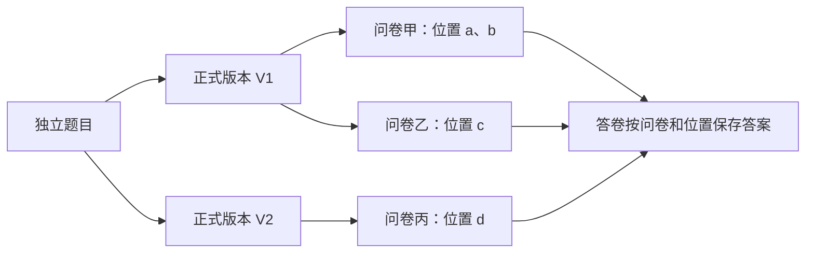

# 基于 MongoDB 的问卷系统第二阶段项目完成报告

项目仓库：https://github.com/sakannnna/DMS-majorProject

姓名：陈建宇　　学号：10245501441

报告日期：2026年10月24日

## 本阶段完成情况

本阶段在第一阶段系统上完成了可复用题目、版本历史与恢复、指定账号共享、个人题库、使用追踪和跨问卷统计。原有问卷、答卷及主要功能继续保留，通过不可变版本和问卷快照隔离后续修改。开发中结合自动测试、实际网页操作和数据库核对验证结果，并根据试用反馈调整前端交互、检查交付环境。

| 重点工作 | 已完成的处理与验证 |
| --- | --- |
| 在原系统上扩展 | 保留原四集合，新增五集合；显式备份升级，核对旧数据未变，并验证旧功能和恢复流程 |
| 保证复用后数据仍可解释 | 区分题目、版本和卷内位置；旧卷不随改题变化，同版重复选入不覆盖答案 |
| 明确共享权限与统计口径 | 按准确版本授权；共享题目不开放私有答卷；回答条数、答卷份数和去重账号数分别计算 |
| 测试与实际验收 | 最近完整回归106项通过；后续10项精选检查通过；固定网页样本与独立落库核对一致 |
| 改善使用与交付 | 调整取消、返回、选题和版本操作；验证全新虚拟环境、空库及中文和空格路径下的网页运行 |

使用追踪和跨卷统计限本人有权查看的问卷，不包含他人结果授权、跨版本合并及旧答案自动绑定。具体规则及其理由如下。

## 一 项目目标与需求变化

第一阶段已经完成注册登录、问卷编辑与发布、配置式跳转和校验、填写提交及单卷统计，题目嵌入各自问卷保存。第二阶段新增题目复用、共享、历史与版本共存、使用追踪、题库和跨卷统计，使题目需要成为可独立管理的资源。

直接复制题干无法追踪同一道题；多个问卷读取一份可变题目，又会让旧内容随修改变化。因此，本阶段保留 Python、FastAPI、PyMongo 和原生 JavaScript 技术栈，在原结构上增加独立题目与正式版本，并让问卷继续保存完整快照。新增需求未明确的版本、撤销和权限边界，先讨论确认，再进入开发。

## 二 系统设计与主要流程

下图表示独立题目、版本、问卷位置和答卷之间的关系。每个位置保存所选版本的内容快照，后续版本变化不会自动替换它。

例如，年龄题V1允许0～120，V2改为0～100。旧卷保留V1，新卷可选V2；同卷两次选V1，也分别保存两个位置的答案。题目详情围绕当前准确版本展示，内容、使用、统计和共享分为页签；问卷一次展开一题，选题弹窗支持连续选入。

| 操作场景 | 系统行为 |
| --- | --- |
| 修改或恢复题目 | 草稿可编辑；正式内容不覆盖。可从旧版分支，恢复旧内容也生成新版本 |
| 问卷选题与换版 | 固定选定版本；草稿由创建者主动换版，发布后题目与填写设置冻结 |
| 共享与派生 | 指定账号、指定版本授权；接收者可直接使用，或派生为自有题目并保留来源 |
| 撤销共享 | 阻止新选用和新派生；已有草稿仍可发布，自有派生题继续存在 |
| 题库分类与归档 | 题库条目独立换版，不替换已保存问卷；归档保留引用，受限来源显示占位 |

来源关系只用于追溯，不授予读取权限。题目作者不能借共享读取接收者的私有问卷与答案。未加入题库的普通题仍可沿用原流程。

**第一阶段到第二阶段的调整。** 第一阶段围绕账号、问卷管理、填写提交和单卷统计组织程序。第二阶段保留这些流程，在问卷保存中增加版本引用检查，新增题目管理、共享与跨卷统计模块；填写和提交继续使用原卷内题号，旧链接及统计入口保持可用。

| 第一阶段设计 | 新需求带来的问题 | 第二阶段修改 | 兼容与验证 |
| --- | --- | --- | --- |
| 题目及规则嵌入各自问卷 | 复制题目无法追溯；直接共享可变内容又会改变旧卷 | 保留原编辑接口，增加独立题目与版本管理；选入时保存准确版本和快照 | 旧普通题继续填写；改版不改旧快照，重复位置分别保存答案 |
| 创建者只管理自己的问卷，没有题目共享 | 需要让他人复用，又不能开放私有答案 | 增加版本授权、接收者派生及个人题库；来源读取单独检查权限 | 撤销阻止新使用，旧草稿仍可发布；双方私有统计不混入 |
| 答案关联卷内题号，只按单卷统计 | 同一题跨卷及同卷重复出现，需要识别共同来源和不同位置 | 保留原答卷与单卷接口，新增按来源版本、问卷和位置匹配的聚合 | 原单卷仍按份数统计；跨卷固定样本得到5条、4份、2账号、平均30 |
| 四集合支撑原业务，初始化只识别原结构 | 新资源及引用需要新增集合、索引和结构规则 | 原账号、会话和答卷结构保留，新增五集合；用升级工具接入旧库 | 验证旧卷提交、备份恢复、重复升级及旧数据内容不变 |

## 三 MongoDB 数据结构及修改理由

共使用九个集合，原有四集合继续保留，新增五集合管理复用资源。

| 集合 | 保存内容及设计考虑 |
| --- | --- |
| users、sessions | 原账号与会话结构保持不变 |
| surveys | 问卷及嵌入题目；增加来源系列、版本标识，仍保存完整内容快照 |
| responses | 每份提交及其嵌入答案；沿用卷内题号和问卷版本，识别同一次提交的重试 |
| reusableQuestions | 题目系列的所有者、管理名称、草稿、归档状态和编辑修订 |
| questionVersions | 不可变正式内容、系列内版本号和父版本；独立保存持续增长的历史 |
| questionShares | 版本与接收账号的授权；撤销改状态，不删除原版本 |
| questionBanks、questionBankItems | 个人题库及条目引用；条目记录选定版本和独立修订号 |

题目、选项、校验和跳转通常随问卷一起读取和修改，因此嵌入问卷，便于整体读取和原子保存。关系数据库同样可以实现这些需求，但本项目不把每个选项和条件机械拆成表，而是按共同读写的范围组织文档，减少常用操作重新拼装定义的步骤；独立增长和共享的版本、答卷及分类条目则单独保存。这是结合访问方式和课程要求采用MongoDB的取舍，并非关系数据库不能表达这些关系。

快照是有意保留的冗余：正式版本不可变、发布后冻结，避免副本随意更新；填写不依赖来源当时是否可访问，旧答卷也始终能按原定义解释。来源归属与权限由后端检查。

索引分别服务于查询与约束：按所有者、归档状态和更新时间列题目；系列内版本号及保存键唯一，防止重复版本；版本与接收者唯一，防止重复授权；题库内系列唯一，条目可主动换版；问卷所有者与来源版本支持使用追踪。答卷保留同键提交及限填一次的唯一索引，分页排序加入答卷ID和卷内位置，处理相同时间的记录。

问卷集合兼容新旧结构，历史答卷无需重写。完整字段、索引及对应查询见[需求与设计](需求与设计.md)，接口输入、输出和页面使用字段见[API说明](API说明.md)。

## 四 跳转、校验及一致保存

跳转保留第一阶段解释器：单选匹配选项，多选支持包含任一或全部，数字支持比较条件；只向后跳，首条命中生效，未命中进入下一题。END只到提交确认，明确提交才保存。返回改答后清除后续旧答案，后端重新计算有效路径，拒绝路径外答案。

题型、题干、选项和校验属于正式版本；必答、顺序与跳转属于卷内位置。换版或删除位置时校验整卷，若新版本删除了规则所依赖的选项，或者位置仍被跳转引用，须同时处理冲突后才能保存。配置与回答都校验合法性，数字须能精确表示为Decimal128，空答与数字零分别处理；客户端不能编辑快照后继续冒用原版本标识。

整卷保存和单个位置操作共用校验规则。删除后重新加入题目，需要重新检查权限并分配位置ID。保存时核对编辑版本，避免多个页面互相覆盖；同一操作重试也不会重复插入题目。同一次答卷提交重试时返回原结果，避免重复保存。

版本保存涉及系列与版本两个文档，处理顺序为：**记录待保存内容与版本号 → 写入正式版本 → 清理临时状态**。网络中断或原请求丢失后，可从页面继续完成同一次保存。若待保存记录不完整，则停止写入并保留原数据。已通过最后一次权限检查的保存允许完成，撤销共享后不再接受新的选用或派生。

## 五 跨问卷统计与旧数据兼容

统计先确定准确版本和本人问卷范围，再按“问卷＋卷内位置”匹配有效答案。不同版本、独立派生题及没有来源的旧普通题不自动合并。旧卷导出只建立可复用资源，历史答案继续留在原卷统计。

| 指标 | 计数方式 |
| --- | --- |
| 有效回答条数 | 同一答卷的两个位置都回答时计2条；跳过及选填未答不计入 |
| 答卷份数 | 上述两个位置来自同一份提交，计1份 |
| 去重账号数 | 同一账号在选定范围内提交多次或跨卷填写，仍只计1个账号 |

数字按有效答案条目计算平均、最小、最大及数值分布，1与1.0归入同一数值。匿名隐藏账号展示，内部关联仅用于约束与去重；单卷原有份数口径保持不变。明细按提交时间、答卷ID及位置ID排序，分页不会将同卷重复位置合并。

旧数据库升级前先停止应用并备份，再运行升级工具；发现不支持的数据结构或升级未完成时，应用会停止启动。旧题即使没有题库来源信息，也能继续填写和统计。测试验证了备份恢复、重复升级、中断后重试及旧问卷继续提交；升级前后逐条比较原有账号、问卷和答卷，内容保持一致。不支持新版数据结构的旧程序也会停止启动，防止覆盖新版规则。

## 六 AI 使用与实际修改

**AI帮了什么。** 本项目使用Codex辅助需求分析、数据与接口设计、代码实现、自动测试、网页检查和文档整理。AI根据确认的规则，在第一阶段系统上分步实现题目版本、共享、题库和跨卷统计，并整理升级及测试材料。具体编码、自动测试和标明的浏览器操作由AI完成，我负责审查方案、提出修改和实际试用。

**AI做错了什么。** AI生成的代码和测试都出现过遗漏。数字版本选入问卷时，没有处理好MongoDB的Decimal128与请求模型之间的转换，导致3项测试失败；独立题目编辑器切换题型时，误用了问卷编辑上下文，使页面控件被锁定。新建题目又使用了内置浏览器不支持的prompt输入，而此前网页检查通过API预先准备题目，绕过了真正的新建入口，因此没有及时发现问题。

前端实现也有不符合实际使用习惯的地方：取消另存仍提示“已保存”，管理名称与正式题干容易混淆，加入题库后没有回到原题目，多个操作按钮直接并列。调整后还出现过关闭选题弹窗时，迟到请求继续更新已移除节点而报错。这些问题说明，接口测试通过不能代替真实入口、取消和返回等完整操作的检查。上述代码问题由AI修复并复测，具体过程见第八部分及日志。

**我改了什么。** 我主要修改规则说明、验收要求和使用流程，具体代码修复交由AI完成。测试方面，我发现已有检查覆盖了填写答案越界，却遗漏创建者配置的数字上下限本身可能超出存储范围，要求补上这类配置校验；我还指出“多少人选择”不能直接用答卷份数表达，重复提交时必须区分份数与去重账号数。对于测试材料，我要求按老师规定的六类组织，写清输入、预期保存的数据和实际结果，并把合法答案准确保存、返回改答清理旧值等纳入核对。

试用时，我提出了取消提示、名称显示、来源查看和题库返回的问题，并要求先评估整体交互层级，再保持功能不变进行调整。原第7—9步验收过于复杂，我要求AI补做固定样本和共享撤销流程，核对结果后才将其记为通过；这些补做由AI操作，不作为我亲自完成的测试。

**我设计了什么。** 在AI提出版本、快照和共享方案后，我重点确定了复用、权限变化和统计的业务边界。同一道可复用题目允许在同一问卷多次选入，每次必须有独立位置，可分别配置必答和跳转；跨卷统计按有效回答条数累计，账号在范围内去重，同时保留答卷份数，避免一种指标代替另一种。

我还明确了撤销共享后的保留范围：禁止新增选用和派生，但撤销前已保存的草稿可以继续发布，已经归接收者所有的派生题仍然有效。来源关系需要保留，却不能自动授予内容访问权；来源不可读时应显示受限占位，不能越权或报错。版本分支、主动换版及旧题导出不自动并入历史答案等方案经过讨论后确认，再由AI细化实现。这些是本项目采用的设计取舍，不作为作业原文明示的要求。使用过程与验证依据见[AI使用日志](AI使用日志.md)。

## 七 测试结果与验证边界

用例覆盖创建问卷、添加题目、跳转、校验、提交、统计六类，并扩展权限、版本、中断恢复、旧库兼容及前端时序检查。自动测试连接真实MongoDB随机独立库；网页操作与API准备数据分别记录。

| 验证项目 | 主要结果与范围 |
| --- | --- |
| 前端调整后的完整自动测试 | 106项通过，51.04秒，零失败、错误和跳过；包含前端交互整理后的回归 |
| 启动兼容与冒烟检查 | 10项通过，2.95秒；覆盖主流程冒烟、错误传递、取消返回、迟到请求及5种启动路径检查，未重跑全量 |
| 固定样本网页验收 | 两卷五条有效答案10、20、30、40、50，实际为5条／4份／2账号，平均30；只选S1为3条／2份／1账号，平均20 |
| 撤销共享后的网页验收 | 接收者旧草稿仍可发布，填25后为1条／1份／1账号；原作者仍为5条／4份／2账号，双方私有结果不混入 |
| 有限并发正确性 | 100账号、最多10个工作线程，首次和同键重试各100次成功，最终100份、100账号，答案及统计吻合固定预期 |
| 分页检查 | 22条样本按20＋2展示，明细无重无漏；数值0～21，平均10.5 |
| 全新环境与网页 | 中文及空格目录中新建虚拟环境，安装锁定依赖、检查空库启动；网页注册至提交统计通过，确认前0份、提交后1份，选项计数1／0 |

跨卷统计和撤销共享验收中的建卷、填写及五次正式提交均由AI在网页操作，再独立读取数据库核对；编辑器预览和分页检查中的部分样本由API准备。运行环境检查使用Windows 11、Python 3.12.10及MongoDB 8.3.11，在中文和空格目录中重新建立Python环境，连接空测试库，完成网页创建、提交与统计。

环境检查仍在本机进行，其他操作系统、旧浏览器及长期稳定性尚未验证。并发测试检查保存和统计的正确性，不用于估计系统容量。详细步骤、输入、预期及实际结果见[测试记录](测试记录.md)。

## 八 实际问题及处理

| 实际问题 | 原因及处理 | 验证结果 |
| --- | --- | --- |
| 数字版本选入出现3项失败 | Decimal128直接进入请求模型；修正序列化边界 | 专项复测及后续完整回归通过 |
| 编辑器上下文和新建入口异常 | 独立编辑误入问卷上下文；网页新建使用了不支持的prompt输入。分别修正渲染分支并改用页面输入窗口 | 实际重走新建、编辑、取消和另存流程 |
| 取消、返回和菜单操作不直观 | 根据本人试用反馈修正另存提示、管理名与题干区分、来源展开和题库返回；再整理页签与操作层级 | 前端专项与独立网页核对通过，取消未写库 |
| 关闭选题弹窗后出现页面错误 | 迟到请求更新已移除节点；丢弃失效结果并串行处理选题动作 | 新增时序检查，后续网页及完整回归通过 |
| 换电脑依赖原D盘路径 | 启动脚本增加指定路径、PATH和常见安装目录发现，补首次运行说明 | 路径发现检查及全新虚拟环境运行通过 |

## 九 交付与运行说明

项目仓库包含前后端源码、MongoDB数据结构与升级工具、依赖配置、使用说明、测试用例、AI使用日志及两阶段报告。第一阶段代码通过Git标签保留，可对照第二阶段的扩展。

首次运行和环境准备见README，建议使用Python 3.12、MongoDB Server及新版Chrome或Edge。使用空库时，系统自动创建集合和索引，注册账号后即可操作；已有旧数据库须先备份并升级。交付材料不包含本机数据库、账号、备份或虚拟环境。
