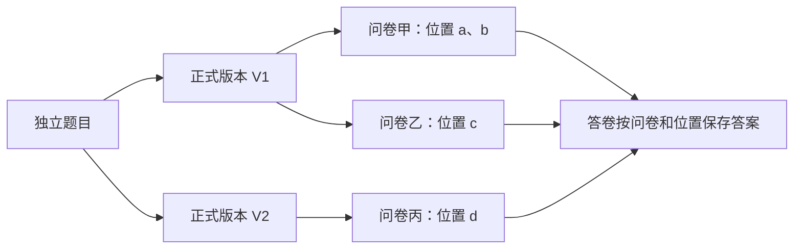

# 基于 MongoDB 的问卷系统第二阶段项目完成报告

项目仓库：https://github.com/sakannnna/DMS-majorProject

姓名：陈建宇　　学号：10245501441

报告日期：2026年10月24日

## 本阶段完成情况

本阶段在第一阶段系统上完成了可复用题目、版本历史与恢复、指定账号共享、个人题库、使用追踪和跨问卷统计。原有问卷、答卷及主要功能继续保留，通过不可变版本和问卷快照隔离后续修改。开发中结合自动测试、实际网页操作和数据库核对验证结果，并根据试用反馈调整前端交互、检查交付环境。

| 重点工作 | 已完成的处理与验证 |
| --- | --- |
| 在原系统上扩展 | 保留原四集合，新增五集合；显式备份升级，核对旧数据未变，并验证旧功能和恢复流程 |
| 保证复用后数据仍可解释 | 区分题目、版本和卷内位置；旧卷不随改题变化，同版重复选入不覆盖答案 |
| 明确共享权限与统计口径 | 按准确版本授权；共享题目不开放私有答卷；回答条数、答卷份数和去重账号数分别计算 |
| 验证结果而非仅检查接口成功 | 最近完整回归106项通过；后续10项精选检查通过；固定网页样本与独立落库核对一致 |
| 改善使用与交付 | 调整取消、返回、选题和版本操作；验证全新虚拟环境、空库及中文和空格路径下的网页运行 |

使用追踪和跨卷统计限本人有权查看的问卷，不包含他人结果授权、跨版本合并及旧答案自动绑定。具体规则及其理由如下。

## 一 项目目标与需求变化

第一阶段已经完成注册登录、问卷编辑与发布、配置式跳转和校验、填写提交及单卷统计，题目嵌入各自问卷保存。第二阶段新增题目复用、共享、历史与版本共存、使用追踪、题库和跨卷统计，使题目需要成为可独立管理的资源。

直接复制题干无法追踪同一道题；多个问卷读取一份可变题目，又会让旧内容随修改变化。因此，本阶段保留 Python、FastAPI、PyMongo 和原生 JavaScript 技术栈，在原结构上增加独立题目与正式版本，并让问卷继续保存完整快照。新增需求未明确的版本、撤销和权限边界，先讨论确认，再进入开发。

## 二 系统设计与主要流程

下图表示独立题目、版本、问卷位置和答卷之间的关系。每个位置保存所选版本的内容快照，后续版本变化不会自动替换它。

例如，年龄题V1允许0～120，V2改为0～100。旧卷保留V1，新卷可选V2；同卷两次选V1，也分别保存两个位置的答案。题目详情围绕当前准确版本展示，内容、使用、统计和共享分为页签；问卷一次展开一题，选题弹窗支持连续选入。

| 操作场景 | 系统行为 |
| --- | --- |
| 修改或恢复题目 | 草稿可编辑；正式内容不覆盖。可从旧版分支，恢复旧内容也生成新版本 |
| 问卷选题与换版 | 固定选定版本；草稿由创建者主动换版，发布后题目与填写设置冻结 |
| 共享与派生 | 指定账号、指定版本授权；接收者可直接使用，或派生为自有题目并保留来源 |
| 撤销共享 | 阻止新选用和新派生；已有草稿仍可发布，自有派生题继续存在 |
| 题库分类与归档 | 题库条目独立换版，不替换已保存问卷；归档保留引用，受限来源显示占位 |

来源关系只用于追溯，不授予读取权限。题目作者不能借共享读取接收者的私有问卷与答案。未加入题库的普通题仍可沿用原流程。

## 三 MongoDB 数据结构及修改理由

共使用九个集合，原有四集合继续保留，新增五集合管理复用资源。

| 集合 | 保存内容及设计考虑 |
| --- | --- |
| users、sessions | 原账号与会话结构保持不变 |
| surveys | 问卷及嵌入题目；增加来源系列、版本标识，仍保存完整内容快照 |
| responses | 每份提交及其嵌入答案；沿用卷内题号、定义版本和原提交幂等规则 |
| reusableQuestions | 题目系列的所有者、管理名称、草稿、归档状态和编辑修订 |
| questionVersions | 不可变正式内容、系列内版本号和父版本；独立保存持续增长的历史 |
| questionShares | 版本与接收账号的授权；撤销改状态，不删除原版本 |
| questionBanks、questionBankItems | 个人题库及条目引用；条目记录选定版本和独立修订号 |

一份问卷的内容与规则适合嵌入读取和原子保存；不断增长的版本、答卷、共享和分类条目则独立存储，避免根文档无限增大。快照使填写不依赖来源当时是否仍可访问，也使旧答卷始终能按原定义解释。版本引用的归属与权限由后端校验。

索引分别服务于查询与约束：按所有者、归档状态和更新时间列题目；系列内版本号及保存键唯一，防止重复版本；版本与接收者唯一，防止重复授权；题库内系列唯一，条目可主动换版；问卷所有者与来源版本支持使用追踪。答卷保留同键提交及限填一次的唯一索引，分页排序加入答卷ID和卷内位置，处理相同时间的记录。

surveys兼容结构版本1和2，responses保持原版本1。完整字段、索引和对应查询见[需求与设计](需求与设计.md)，接口输出与前端消费约定见[API说明](API说明.md)。

## 四 跳转、校验及一致保存

跳转保留第一阶段解释器：单选匹配选项，多选支持包含任一或全部，数字支持比较条件；只向后跳，首条命中生效，未命中进入下一题。END只到提交确认，明确提交才保存。返回改答后清除后续旧答案，后端重新计算有效路径，拒绝路径外答案。

题型、题干、选项和校验属于正式版本；必答、顺序与跳转属于卷内位置。换版或删除位置时校验整卷，若新版本删除了规则所依赖的选项，或者位置仍被跳转引用，须同时处理冲突后才能保存。配置与回答都校验合法性，数字须能精确表示为Decimal128，空答与数字零分别处理；客户端不能编辑快照后继续冒用原版本标识。

整卷保存和单个位置操作共用来源、授权和修订检查。删除后重加视为新选用，重新授权并生成位置ID；编辑修订号和操作回执防止并发覆盖与重复插入。答卷仍使用持久提交键去重。

版本保存涉及系列与版本两个文档，处理顺序为：**写入固定保存预留 → 插入正式版本 → 清理预留**。请求丢失时，所有者可从“完成中断保存”恢复同一操作；损坏预留停止本系列写入并保留记录。撤销以最后授权检查为准入点，已经准入的在途操作允许完成。

## 五 跨问卷统计与旧数据兼容

统计先确定准确版本和本人问卷范围，再按“问卷＋卷内位置”匹配有效答案。不同版本、独立派生题及没有来源的旧普通题不自动合并。旧卷导出只建立可复用资源，历史答案继续留在原卷统计。

| 指标 | 计数方式 |
| --- | --- |
| 有效回答条数 | 同一答卷的两个位置都回答时计2条；跳过及选填未答不计入 |
| 答卷份数 | 上述两个位置来自同一份提交，计1份 |
| 去重账号数 | 同一账号在选定范围内提交多次或跨卷填写，仍只计1个账号 |

数字按有效答案条目计算平均、最小、最大及数值分布，1与1.0归入同一数值。匿名隐藏账号展示，内部关联仅用于约束与去重；单卷原有份数口径保持不变。明细按提交时间、答卷ID及位置ID排序，分页不会将同卷重复位置合并。

旧库接入先停写、备份，再显式升级；预检发现未知结构或升级不完整时拒绝写入。无来源字段的旧题继续填写和统计，不批量改写原答卷。独立库验证了备份恢复、重复升级、中断重跑和旧卷继续提交；本机升级前后逐文档BSON哈希核对，原3账号、4问卷、3答卷未变。原阶段程序也会拒绝不支持的新结构，避免旧初始化覆盖新版约束。

## 六 AI 使用与实际修改

本项目使用Codex辅助分析、编码、测试、网页检查和文档整理。本人主要负责提出需求、审查总体方案和验收方式，确定重复位置、共享撤销、来源权限、旧题导出及统计口径，并在试用后反馈操作问题；具体代码、自动测试和标明的浏览器操作由AI完成。

推进顺序为规则确认、数据与接口设计、兼容与测试设计，再分两部分开发。第一部分实现题目、版本和选入，第二部分接通共享、题库、使用与统计。之后根据试用反馈调整前端，用预先计算的样本、实际网页提交和独立数据库核对检查结果。日志经授权按工作批次整理，提示词摘要、决定、产出及修改原因见[AI使用日志](AI使用日志.md)。报告初稿也由AI整理，本人审阅内容并提出结构调整。

## 七 测试结果与验证边界

用例覆盖创建问卷、添加题目、跳转、校验、提交、统计六类，并扩展权限、版本、中断恢复、旧库兼容及前端时序检查。自动测试连接真实MongoDB随机独立库；网页操作与API准备数据分别记录。

| 验证项目 | 主要结果与范围 |
| --- | --- |
| 最近完整回归（M批） | 106项通过，51.04秒，零失败、错误和跳过；包含前端交互整理后的回归 |
| 最新精选检查（O批） | 10项通过，2.95秒；覆盖主流程冒烟、错误传递、取消返回、迟到请求及5种启动路径检查，未重跑全量 |
| 固定样本网页验收（N批） | 两卷五条有效答案10、20、30、40、50，实际为5条／4份／2账号，平均30；只选S1为3条／2份／1账号，平均20 |
| 撤销共享后的网页验收（N批） | 接收者旧草稿仍可发布，填25后为1条／1份／1账号；原作者仍为5条／4份／2账号，双方私有结果不混入 |
| 有限并发正确性（T24） | 100账号、最多10个工作线程，首次和同键重试各100次成功，最终100份、100账号，答案及统计吻合固定预期 |
| 分页检查（J批） | 22条样本按20＋2展示，明细无重无漏；数值0～21，平均10.5 |
| 全新环境与网页（O批） | 中文及空格目录中新建虚拟环境，安装锁定依赖、检查空库启动；网页注册至提交统计通过，确认前0份、提交后1份，选项计数1／0 |

N批的建卷、填写、授权和五次正式提交均由AI通过网页操作，Python只读数据库核对；J/M批部分统计样本则由API准备。O批使用Windows 11、Python 3.12.10及MongoDB 8.3.11，复用本机MongoDB进程但使用新建独立库，应用从交付副本导入。完整回归与精选检查均保留1条既有依赖弃用警告。

未测试另一台物理电脑、macOS/Linux、旧浏览器、长期稳定或压力极限；有限并发结果不等同于100人真实在线容量。详细步骤、输入、预期和实际结果统一见[测试记录](测试记录.md)，报告只归纳关键结果。

## 八 实际问题及处理

| 实际问题 | 原因及处理 | 验证结果 |
| --- | --- | --- |
| 数字版本选入出现3项失败 | Decimal128直接进入请求模型；修正序列化边界 | 专项复测及后续完整回归通过 |
| 编辑器上下文和新建入口异常 | 独立编辑误入问卷上下文；网页新建使用了不支持的prompt输入。分别修正渲染分支并改用页面输入窗口 | 实际重走新建、编辑、取消和另存流程 |
| 取消、返回和菜单操作不直观 | 根据本人试用反馈修正另存提示、管理名与题干区分、来源展开和题库返回；再整理页签与操作层级 | 前端专项与独立网页核对通过，取消未写库 |
| 关闭选题弹窗后出现页面错误 | 迟到请求更新已移除节点；丢弃失效结果并串行处理选题动作 | 新增时序检查，后续网页及完整回归通过 |
| 换电脑依赖原D盘路径 | 启动脚本增加指定路径、PATH和常见安装目录发现，补首次运行说明 | 5种路径检查及全新虚拟环境验证通过；未将其称为陌生电脑实际双击验收 |

另有一轮测试在数据库初始化阶段收到操作取消，根因未确定。保留原始失败输出，将测试清理放入finally，随后完整复跑通过；未把准备阶段异常归为已查明的业务错误。故障注入用于验证恢复，与自然出现的缺陷分开记录。

## 九 交付材料与版本说明

交付材料包括前后端源码、MongoDB结构与升级工具、锁定依赖及启动脚本、README、设计与API说明、测试用例和证据、AI日志及两阶段报告。第一阶段基线由 `stage1-final` 保留；第二阶段主要实现为 `d1cc7b7`、`0ecc601`，最终提交以 `stage2-final` 标签标记，源码、测试和报告通过交付版本证据中的哈希对应。

README提供首次安装、自动寻找MongoDB、空库注册和旧库升级方法。交付不附本机数据库、账号、备份或虚拟环境；必要历史基线用于旧程序保护测试。推荐Python 3.12、MongoDB Server和新版Chrome/Edge。版本证据区分106项完整回归与后续10项精选检查。
