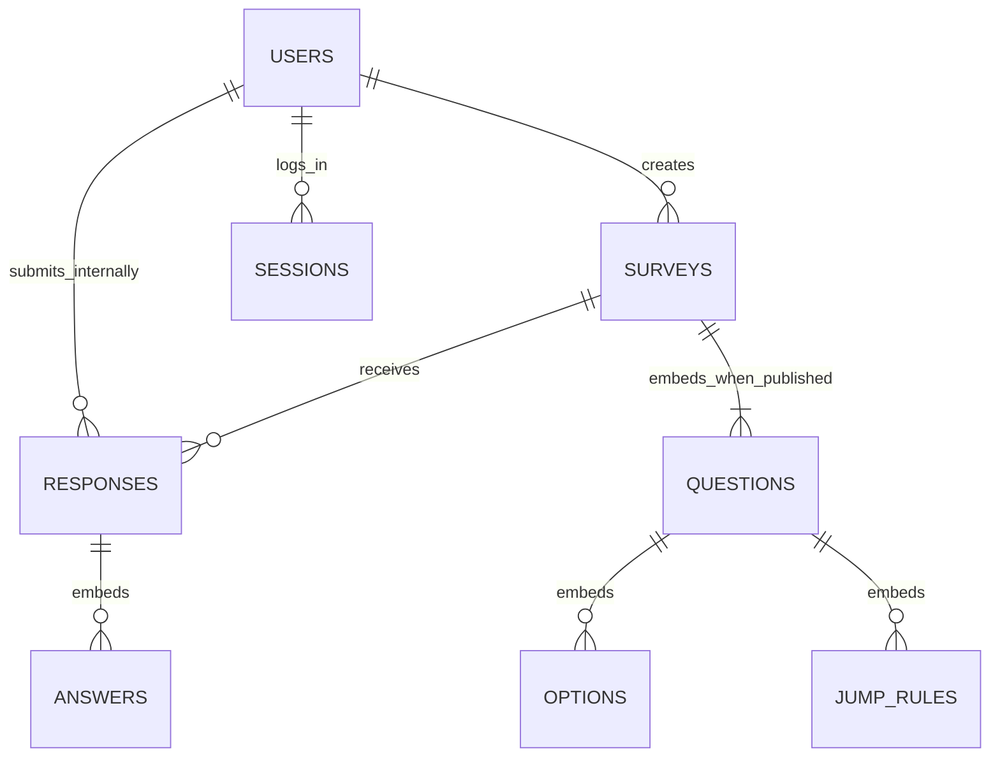

# 第一阶段需求与总体设计

当前说明：已确认并按实现维护。教师要求来自[原始作业文档](../大作业一第一阶段.docx)；工作方法见[规范](工作与记录规范.md)。

本文只维护当前有效的需求与实现设计。功能清单的“明确要求”来自教师原文，其余业务解释和技术选择是本项目已采用的设计规则，不冒充作业原文明示要求。历史讨论与变更原因见[AI使用日志](AI使用日志.md)。

## 范围和功能清单

| 编号 | 明确要求 | 来源 | 验收边界与设计状态 |
| --- | --- | --- | --- |
| R01 | 注册、登录；用户含用户名、密码、注册时间 | 初始需求一 | 用户名唯一，密码保存安全哈希；注册、登录错误可见；补充退出登录 |
| R02 | 用自己的账号创建问卷；只能看到自己创建的问卷列表和统计 | 初始需求一、六 | 所有管理读取、写入和统计均校验当前用户为创建者；有链接不授予管理权 |
| R03 | 标题、说明、是否匿名；发布、截止时间、关闭；访问链接 | 初始需求二 | 项目规则已确认：发布后可改标题、说明、截止时间，冻结题目、选项、校验、跳转及匿名和重复设置；已关闭不能重开 |
| R04 | 添加多个题目；单选含选项和必答约束 | 初始需求三 | 单选答案只能来自当前题目的选项；题目和选项使用稳定标识 |
| R05 | 多选可限制至少、至多或恰好若干项 | 初始需求三 | 去除歧义：重复选项拒绝；恰好 N 项表示最小和最大均为 N；配置本身也要校验 |
| R06 | 文本最少和最多字数；数字最小、最大、整数限制 | 初始需求三 | 前端提示，后端权威校验；边界包含端点；空值与数值 0 分开处理 |
| R07 | 通过配置实现单选、多选、数字条件跳转 | 初始需求四 | 项目规则已确认：只向后跳或结束、首条命中生效，未命中进入下一题；结束进入提交确认，不自动提交 |
| R08 | 经链接、登录后按顺序填答、跳转、报错、提交，每次填写保存 | 初始需求二、五 | 每次成功提交保存一份完整答卷；尚未提交的浏览器内容不承诺持久化，作为默认解释 |
| R09 | 多人同时填写、匿名填写、允许时同人多次填写 | 初始需求五 | 每人一次或多次按问卷配置；均需登录，匿名仅对创建者隐藏账号，内部保留用户关联；并发重复由数据库唯一约束兜底 |
| R10 | 整卷及单题统计：单选选项数量与回答总数、多选选项次数、填空明细、数字平均值，自动生成 | 初始需求六 | 统计只依据成功提交答卷，按题处理跳过和空值；具体计数口径见统计说明 |
| R11 | MongoDB 存全部数据，无关系数据库、无现成问卷框架；解释设计理由 | 第三、四节 | 用户、会话、问卷、答卷均在 MongoDB；配置文件只保存运行配置，不充当业务数据仓库 |
| R12 | 完成测试、代码、系统与数据库及 API 文档、关键逻辑说明、项目报告和真实 AI 记录 | 第五至七节 | 覆盖六类必测及权限和并发边界；交付逐项核对，不将计划当结果 |
| R13 | 第二阶段沿用第一阶段核心结构和主要功能、保留旧数据，说明变更与兼容性 | 第二节 | 保存阶段基线；稳定标识、结构版本及回归用例支撑扩展，不预做未知功能 |

为控制课程作业规模，不纳入：管理员后台、邮箱找回、团队协作、富文本与文件题、模板市场、作答过程自动保存、答卷编辑、复杂可视化报表、导出、云部署及高并发性能指标。教师没有明确要求这些功能。草稿内修改和排序题目属于完成配置所需的基本编辑能力；发布后编辑按已确认的项目规则执行。

## 技术栈和结构

**技术栈已确认**：Python 3.12、FastAPI、PyMongo 同步驱动、MongoDB、Jinja2 与少量原生 JavaScript；用 Uvicorn 运行，Pydantic 处理请求结构，pytest 与 FastAPI TestClient 进行测试。前后端同源部署为一个小应用，问卷编辑先用普通表单和上下移动按钮，避免引入独立前端构建流程。

选择理由：Python 能清楚表达校验和规则求值；PyMongo 直接呈现 MongoDB 操作，便于课程报告解释；FastAPI 提供请求模型与接口文档；模板页面满足简单界面要求。FastAPI 官方提供 [Jinja2 模板方式](https://fastapi.tiangolo.com/advanced/templates/)和 [TestClient 与 pytest 测试方式](https://fastapi.tiangolo.com/tutorial/testing/)。同步数据库调用放在适当的同步请求处理路径，避免阻塞异步事件循环，参考[同步与异步说明](https://fastapi.tiangolo.com/async/)。这些是本项目的选型理由，不是教师指定技术。

采用本地 MongoDB 与独立测试库，不要求 Docker、云数据库或副本集。环境探查与启动检查方法见[README](../README.md)，依赖版本由 requirements.txt 固定。

保持一个应用、少量职责模块：页面与 API 路由负责输入输出；业务模块处理权限、生命周期、校验、跳转与统计；数据库访问模块负责集合、索引和存储；模型负责请求和存储结构。页面与 API 复用同一业务逻辑，不写两套后端规则，也不建立微服务或通用规则平台。

## 权限边界

以下是对 R01、R02、R08 采用的项目解释。“只能看到自己的问卷”限制管理列表和管理接口，不阻止已登录用户通过分享链接填写别人的问卷，否则与分发填写要求冲突。

| 操作 | 未登录访问者 | 已登录填写者 | 当前问卷创建者 |
| --- | --- | --- | --- |
| 注册、登录 | 允许 | 可退出后使用其他账号 | 同左 |
| 问卷管理列表 | 要求登录 | 仅自己的 | 仅自己的 |
| 查看问卷填写页面 | 登录后返回原链接 | 只可访问已发布且可填写的问卷 | 同样遵守提交限制；草稿另设预览且不保存答卷 |
| 创建问卷 | 不允许 | 允许，成为该问卷创建者 | 允许 |
| 编辑、发布、关闭问卷 | 不允许 | 不允许管理他人问卷 | 按生命周期允许 |
| 提交答卷 | 不允许 | 按截止、关闭和重复策略允许 | 允许自填，也遵守相同规则 |
| 查看统计和填空内容 | 不允许 | 不允许查看他人问卷统计 | 允许；匿名身份不可通过统计接口泄露 |

管理查询同时限定问卷标识和当前创建者标识，不只在页面隐藏按钮。公开的填写数据仅含展示题目和执行规则需要的信息，不带账号、会话、其他答卷或管理信息。第一阶段不设全局管理员和其他人的答卷查询入口。

使用随机会话令牌和 HttpOnly Cookie，MongoDB 保存令牌摘要、用户引用和过期时间；退出使会话失效，业务代码检查过期，不依赖延迟清理。密码使用成熟库的 Argon2 哈希。写操作使用 CSRF 防护；模板输出转义，查询按允许字段构造，不接受客户端直接提供 MongoDB 条件。部署时 HTTPS Cookie 设置随运行环境配置。

## 主要流程和生命周期

创建者：注册或登录 → 自己的问卷列表 → 新建草稿 → 配置题目、校验和跳转 → 预览和发布检查 → 发布并复制链接 → 查看统计或关闭问卷。

填写者：打开链接 → 未登录则先登录并返回 → 检查问卷可填写状态及重复策略 → 阅读题目 → 校验当前回答并计算下一题 → 可返回已访问题目修改 → 到达 END 或自然答完最后一题时进入提交确认 → 填写者明确点击提交 → 服务端重新检查状态、截止及完整路径并保存 → 显示提交成功。进入提交确认不写答卷、不占用一次填写名额，也不计入统计。

统计：创建者选择问卷或单题 → 服务端核对归属 → 从答卷聚合或分页读取 → 显示计数、有效样本数和内容。统计读取不依赖手动刷新汇总任务。

状态为“草稿 → 已发布 → 已关闭”。截止是已发布状态上的时间条件，不另存一个可能滞后的“已过期”状态；到截止时按服务器时间拒绝新的准入。**项目规则已确认：已关闭的问卷不能重开**；调整截止时间不能把已关闭状态改回已发布。不做硬删除，无需定时任务改变状态。

**项目规则已确认**：草稿允许配置问卷；发布后冻结题目（含题型、题干、必答和顺序）、选项、校验规则、跳转规则、匿名设置及重复填写设置；允许创建者修改标题、说明和截止时间，并支持关闭和统计。这是本项目采用的设计边界，不是作业原文明示要求。若未来需要发布后改题，再引入问卷修订，不覆盖旧定义。

实现方式：已发布问卷的更新只允许标题、说明、截止时间白名单，禁止通过整份文档替换绕过冻结。可编辑信息变化不增加 definitionVersion，但更新 editRevision 和更新时间；已有答卷仍对应同一套题目定义。标题与说明显示当前值，不额外保存历史快照。最终提交始终读取最新截止和关闭状态，先打开页面或已进入确认页不保证随后仍可提交；延期、缩短和关闭都不删除已有答卷。由于到期不等于关闭，已发布但到期的问卷将截止时间延后可恢复填写，已关闭问卷不受此逻辑影响。

## 核心主体与 MongoDB 组织

**四集合划分已确认**：三个业务集合和一个登录会话集合，即 users、surveys、responses、sessions。具体存储字段以 app/database.py 的 validator 及业务写入为准，接口字段以运行中 OpenAPI 为准；匿名答卷保留内部用户关联，不向创建者输出。

QUESTIONS、OPTIONS、JUMP_RULES、ANSWERS 表示嵌入子文档，并非额外集合；空草稿可以尚无题目。用户与答卷保留内部关联，不向创建者暴露匿名账号。

| 集合 | 核心内容 | 嵌入或引用理由 |
| --- | --- | --- |
| users | 标识、唯一用户名规范值及显示值、密码哈希、注册时间、schemaVersion | 账号独立维护；不把不断增长的问卷、答卷或会话数组塞进用户文档 |
| surveys | 标识、ownerId、分享 token、标题、说明、状态、截止、匿名及重复策略、questions、definitionVersion、editRevision、schemaVersion、创建更新时间 | ownerId 引用用户；题目及其选项、校验和跳转规则嵌入，发布检查与填写常需一起读取，草稿整体保存可原子更新 |
| responses | 标识、surveyId、definitionVersion、内部 respondentId、anonymous、submissionKey、可选 singleSubmissionKey、answers、submittedAt、schemaVersion | 引用问卷和内部填写者；每次提交独立成文档，answers 嵌入使整份答卷一次保存；多人提交不更新同一个问卷大数组 |
| sessions | 标识、tokenHash、userId、expiresAt、createdAt、schemaVersion | userId 引用用户；会话可独立失效和清理，认证信息不复制进业务文档 |

单个题目保存稳定 id（题目标识）、kind、title、required、options、validation 和有序 jumpRules。填空使用kind=text和kind=number区分。选项保存稳定 id（选项标识）与 label（显示文字）。规则的目标引用 questionId 或 END，不使用会随排序变化的题号作为存储标识。

单个答案保存 questionId 和相应的值：单选为 optionId，多选为 optionId 数组，文本为字符串，数字为 Decimal128 可表达的十进制值。请求中的数字需精确解析，不把浮点误差误认为用户输入；不接受 NaN、无穷大或越过支持范围的数字。缺答与空值有明确规则，数值 0 是有效值。请求与输出结构见[API说明](API说明.md)。

**为什么采用这种结构**：问卷及题目是有界的“包含”关系，常一起读、一起验证和发布；答卷会随参与人数持续增长，需要独立插入和聚合。因此同时采用嵌入和引用，既不把所有内容放进一个文档，也不按关系表方式把题目、选项、每个答案都拆成集合。MongoDB 官方说明嵌入可减少共同读取操作并支持单文档原子更新，但文档需小于 16 MiB，见[嵌入设计说明](https://www.mongodb.com/docs/manual/data-modeling/embedding/)。据此限制课程版问卷规模，而不是把所有答卷嵌入问卷。

关系模型也能实现该业务；本作业明确限定 MongoDB，而该文档聚合结构能自然保存异构题型及规则，避免日常读整卷时跨很多集合拼装。引用不等于数据库外键：服务端仍需校验创建者、选项和目标题目存在且属于同卷。

冗余控制：不复制用户名、完整题干、整份问卷到每个答案，不维护另一份统计计数。答卷保存 definitionVersion 用于解释答案，anonymous 保存提交语义，singleSubmissionKey 只用于约束，不作为第二份用户资料。发布后定义冻结使这些少量字段可保持一致。匿名内部关联方案已由用户确认。

## 查询路径与约束

| 主要访问 | 索引或检查 |
| --- | --- |
| 注册和登录 | users 的用户名规范值唯一索引；冲突由数据库兜底 |
| 我的问卷列表 | surveys 的 ownerId 与 createdAt 组合索引；列表投影不返回 questions 全文 |
| 分享链接访问 | surveys 的 token 唯一索引；链接只定位问卷，不替代登录或状态检查 |
| 会话认证与清理 | sessions 的 tokenHash 唯一索引；expiresAt 的 TTL 索引用于清理，业务主动校验过期 |
| 整卷或单题统计、答卷分页 | responses 的 surveyId 与 submittedAt 组合索引；初始规模不为每个答案字段加索引 |
| 重试去重 | responses 的 surveyId、respondentId、submissionKey 组合唯一索引；重试同键返回同次结果，内容改变则拒绝复用该键 |
| 禁止同人多次提交 | responses 在 singleSubmissionKey 存在的文档上，对 surveyId 与 singleSubmissionKey 建部分唯一索引；单次策略时该键对应内部用户，多次策略不写此键 |

部分唯一索引只约束满足过滤条件的文档，是这里同时支持单次和多次策略的依据，见[MongoDB 部分索引](https://www.mongodb.com/docs/manual/core/index-partial/)。策略由后端从问卷读取，不接受客户端省略 singleSubmissionKey 绕过；发布后策略冻结。

MongoDB validator 检查基础字段、类型与版本；题目 ID 唯一、规则目标及选项归属等跨字段业务约束在服务端校验。草稿保存和发布后可编辑信息的更新均使用 editRevision 条件更新，发布或关闭使用当前状态条件更新，避免两个编辑页面相互覆盖或关闭后被旧页面保存重新打开。

每份答卷以一次文档插入完成，不同时维护独立计数文档，减少跨集合原子性需求。提交前最后一次检查登录、问卷状态、截止及规则，检查通过的时刻作为“本次获准提交”的时刻；已经获准而尚未完成写入的请求，可能在关闭后才返回成功。本项目采用这一边界，不承诺跨集合的严格关闭瞬间线性化；若需要关闭操作返回后绝无在途答卷写入，则要引入事务及协调方案，增加部署与实现成本。多人同账号提交仍通过唯一索引约束，不依赖“先查后插”。

## 校验和跳转

发布检查涵盖：标题与题目非空、选项足够且标识唯一、上下限有序、多选数量不超过选项数、数字和规则操作符匹配、跳转目标存在且方向合法、至少一题，以及定义不超过支持规模。课程版不要求证明任意规则组合必然可达所有题目，但配置错误应给出具体位置。

规则只判断当前题目，表达式为允许的操作符及参数，禁止执行任意脚本：单选“选中某项”；多选“包含任一”“包含全部”；数字等于、不等于、大于、大于等于、小于、小于等于，可用同一规则内 AND 表示区间。每条规则有目标题或 END。**项目规则已确认：按显示顺序首条命中生效，未命中进入下一题；END 只进入提交确认，不自动提交。**空答不匹配规则，多选只在本题确认后跳转，是当前行为。自然答完最后一题同样进入提交确认，只有用户明确提交且后端检查通过后才保存答卷。

**项目规则已确认：只允许向问卷顺序后方跳转或结束，禁止回跳及自跳**，确保路径终止。实现方式：向前返回修改是填写界面操作，不属于自动回跳规则；提交确认页也可返回修改。修改前题后重新计算路径，并清除后续已访问题的旧答案，避免残留不可见答案进入统计。

服务端从第一题重放路径，不信任客户端声明“已完成”或提交的路径；仅对实际到达的题执行必答和类型、数量、长度、范围校验。被跳过的必答题不要求作答，提交包含路径外答案或未知题目、选项时拒绝并要求重新确认。最终答案只保留有效路径中的回答。

多选、文本和数字均支持必答开关，单选必答为明确要求，其他类型的统一开关为本项目设计规则。选填题空答可跳过，填写了内容则执行配置约束。文本长度按去除首尾空白后的 Unicode 码点计数，不承诺等于视觉字形数；长度由服务端权威校验，前端展示约束并用maxlength提供基本输入限制。手机号虽被原文举为整数示例，数字题仍按数值语义校验，前导零不保留；如需按字符串保存手机号可使用文本题，暂不新增专门题型。

## 提交与统计口径

重复策略默认“每账号一次”，创建者可在草稿阶段改为允许多次。匿名开启时由填写者选择是否匿名，默认匿名；关闭时实名。无论是否匿名均先登录。这里的“实名”只指向创建者显示账号名，不涉及现实姓名。该匿名解释已由用户确认，是本项目设计规则。

每次成功提交独立保存且计入统计；同一账号被允许提交多次时按多份答卷计数。原文“多少人选择”在该情况下需要解释为“选择次数及回答份数”，界面直接用“份”或“次”，不将份数冒充去重人数。不另做去重人数报表。

| 项目 | 统计口径 |
| --- | --- |
| 全卷 | 成功提交份数；未完成或提交失败不计入 |
| 单选 | 每选项的答卷数、该题有效回答份数；有效回答份数不一定等于全卷份数 |
| 多选 | 每选项被选择的次数；一份答卷中同一选项最多一次，合计可超过答卷数 |
| 文本 | 分页显示所有有效填写内容，不用一个无限增长结果一次返回 |
| 数字 | 分页内容、有效数值个数及平均值；没有数值时平均值为空，显示“暂无数据”，不显示 0 |
| 跳过或选填未答 | 不进入该题回答数、内容和平均值分母；当前未单独显示未答或跳过数量 |

答卷是统计事实来源，使用 MongoDB 聚合，数字平均值不先转字符串或二进制浮点再计算；显示可适当舍入。统计按提交数据即时计算，各次查询期间可能有新答卷，不承诺跨多次请求的固定快照。非匿名显示账号名，匿名响应不返回 respondentId 或可反推身份的内部去重键；自由文本由填写者自行输入的身份内容不做自动识别脱敏。

## 第二阶段的扩展边界

- 持久化主体保留 schemaVersion，区分“存储结构版本”与问卷 definitionVersion。前者用于结构演进，后者用于解释题目与答卷；editRevision 仅用于并发编辑控制，三者不能混用。
- 稳定 questionId 和 optionId 不随题号或显示文字变化。新增题型和条件在现有模型、校验与求值模块扩展，不把规则写死进某张问卷页面。
- 第一阶段 definitionVersion 固定为已发布的一个版本，尚不建立版本集合或完整修订平台。第二阶段若明确要求发布后改题，再保留原版并增加修订存储；已有答卷仍可定位其原定义。
- 结构迁移使用备份、可复跑迁移或兼容读取，根据实际新需求选择。保留第一阶段标签或交付包和回归用例，不以重建数据库代替迁移。MongoDB 的[结构版本模式](https://www.mongodb.com/docs/manual/data-modeling/design-patterns/data-versioning/schema-versioning/)允许区分共存结构；具体迁移仍须验证索引与读取逻辑。

## 验证与交付定位

测试用例、实际结果和限制只在[测试记录](测试记录.md)维护；完成情况见[阶段一报告](阶段一报告.md)。运行、代码入口和第一阶段Git基线见[README](../README.md)。当前无总体设计未定问题。

## 扩展性推演

以下是假设变更的影响分析，不是已承诺或已实现的第二阶段需求。仅发现实际风险时整理当前代码，不提前建设通用扩展平台。

| 假设变更 | 现有基础和具体障碍 | 后续改动与兼容验证 | 当前处理 |
| --- | --- | --- | --- |
| 新增日期或评分题 | questions按kind建模；模型枚举、prepare/normalize、前端编辑和渲染、统计分支均需改；不能仅添加枚举后沿用数字分支 | 保留旧kind及id，新增专门校验和输出分支，补旧题回归与新题端到端测试；跨全部消费者更新API核对表 | 只补输出边界，未新增题型；不为四种现有输入建立插件系统 |
| 新增跨题条件或回跳 | 当前规则只判断本题，路径重放依赖向后单调推进；直接允许回跳会造成死循环及历史答案歧义 | 先重新确认路径与旧规则语义，再改表达式和遍历器；保留现有向后规则回归 | 当前规则保持不变，不把“数据化规则”误称为任意表达式引擎 |
| 发布后原链接修改题目 | definitionVersion已存答卷，但目前只有一个冻结定义，没有版本解析或历史定义存储 | 增加不可变修订记录及按答卷版本解析；旧答卷必须继续关联原题，统计需决定分版本还是合并 | 不预先拆新集合，第一阶段仍按冻结规则执行 |
| 存储结构升级到v2后误启动旧代码 | 原初始化会collMod覆盖新版validator，单有schemaVersion字段不能保护兼容性 | 显式迁移前备份并定义兼容读写版本；迁移后验证旧数据及索引 | 已加启动前检查：任一已知集合的版本约束不是仅v1，或数据含非v1版本，先报错，全部检查通过后才允许修改validator；不自动迁移或降级 |
| 添加内部审计字段或扩展统计 | 管理接口原来直接序列化存储文档；新增字段可能进入响应，统计前端还依赖分支字段的存在 | 输出模型显式选择对外字段；变更kind、分页或可空字段时同步核对前端和契约测试 | 已增加contracts.py及全部API响应模型；保持已有输出和前端行为 |
| 答卷明显增长 | 答卷独立存储、内容支持分页；整卷统计对每题各自聚合，最多100题会增加扫描次数 | 先量测查询与索引，再按实际规模合并聚合或分批加载；缓存需明确一致性，不能提前持久化第二套计数 | 保留当前实现，未声称通过高负载验证 |

第二阶段继续保留业务库和稳定标识。三个版本字段的职责仍按上文执行；字段存在不等于已支持修订和迁移。当前新增的启动拒绝保护只识别已知四集合的版本信息，不能替代完整迁移计划，也不能发现未标版本的任意语义变化。
