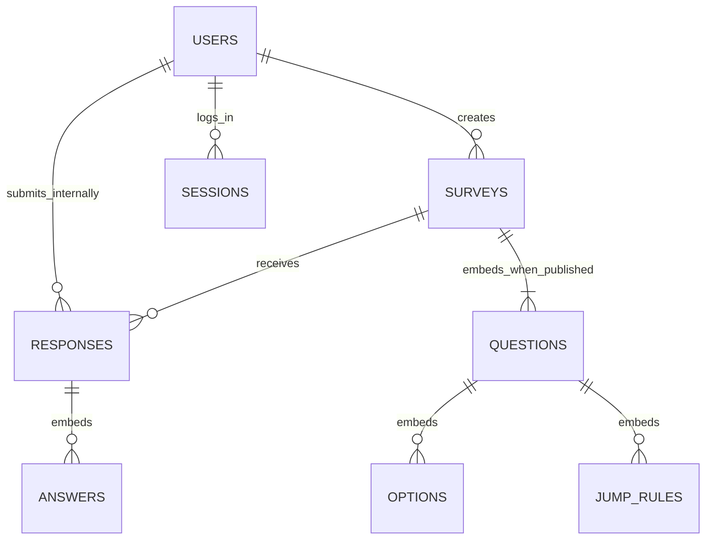
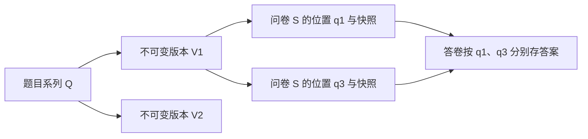

# 需求与总体设计

阅读边界：下文“第一阶段现有实现”描述已实现系统；“第二阶段已确认业务规则”来自用户2026-10-23确认；“第二阶段设计与实施状态”描述第二阶段两部分的实际实现；实际测试结果只在测试记录维护。教师要求来自[原始作业文档](../大作业一第一阶段.docx)；工作方法见[规范](工作与记录规范.md)。

本文原位维护现有实现与第二阶段设计，明确区分状态。第二阶段依据[需求变更原文](../大作业一：需求变更.docx)。功能清单的“明确要求”来自教师原文，其余业务解释和技术选择是本项目已采用的设计规则，不冒充作业原文明示要求。第一阶段历史讨论与变更原因见[AI使用日志](AI使用日志.md)；第二阶段未经用户明确要求不追加AI日志。

## 第一阶段现有实现

### 从使用场景理解系统

以课程调查为例：甲用自己的账号创建问卷，先保存草稿，配置“是否继续”的单选题、意见文本和评分数字题；检查预览后发布。乙登录后打开甲分享的链接，按规则填写并确认提交。甲查看统计，乙只能填写，不能管理甲的问卷。账号的“创建者”和“填写者”是相对某份问卷的角色，同一个账号也可以创建自己的问卷、填写别人的问卷。

系统把**问卷定义**与**答卷**分开：问卷定义是题目、选项和规则，答卷是某次成功提交的答案。打开链接、填写一半或进入确认页，都还不是答卷。允许重复填写时，乙提交两次会留下两份答卷，但只算一个填写账号。

## 主体之间如何关联

一个用户可创建多份问卷，也可提交多份答卷；一份问卷接收多份答卷。一份问卷包含有顺序的题目，每题包含自己的选项、校验和跳转规则；一份答卷包含它实际回答过的题目答案。登录会话用于证明“当前请求来自哪个账号”，不属于问卷内容。

例如甲的问卷S含题目q1、q2；乙的答卷R记录“属于S、由乙提交、q1选a、q2填20”。题目顺序可能在草稿中改变，因此答案使用不随顺序变化的标识q1/q2，不用“第一题/第二题”关联。匿名时R仍在内部关联乙，但对甲只显示“匿名”。下面先说明操作和权限，再解释这些对象怎样存入MongoDB。

## 主要流程和生命周期

创建者：注册或登录 → 自己的问卷列表 → 新建草稿 → 配置题目、校验和跳转 → 预览和发布检查 → 发布并复制链接 → 查看统计或关闭问卷。

填写者：打开链接 → 未登录则先登录并返回 → 检查问卷可填写状态及重复策略 → 阅读题目 → 校验当前回答并计算下一题 → 可返回已访问题目修改 → 到达 END 或自然答完最后一题时进入提交确认 → 填写者明确点击提交 → 服务端重新检查状态、截止及完整路径并保存 → 显示提交成功。进入提交确认不写答卷、不占用一次填写名额，也不计入统计。

统计：创建者选择问卷或单题 → 服务端核对归属 → 从答卷聚合或分页读取 → 显示计数、有效样本数和内容。统计读取不依赖手动刷新汇总任务。

状态为“草稿 → 已发布 → 已关闭”。截止是已发布状态上的时间条件，不另存一个可能滞后的“已过期”状态；到截止时按服务器时间拒绝新的准入。**项目规则已确认：已关闭的问卷不能重开**；调整截止时间不能把已关闭状态改回已发布。不做硬删除，无需定时任务改变状态。

**项目规则已确认**：草稿允许配置问卷；发布后冻结题目（含题型、题干、必答和顺序）、选项、校验规则、跳转规则、匿名设置及重复填写设置；允许创建者修改标题、说明和截止时间，并支持关闭和统计。这是本项目采用的设计边界，不是作业原文明示要求。若未来需要发布后改题，再引入问卷修订，不覆盖旧定义。

实现方式：已发布问卷的更新只允许标题、说明、截止时间白名单，禁止通过整份文档替换绕过冻结。可编辑信息变化不增加 definitionVersion（题目定义版本），但更新 editRevision（编辑修订号）和更新时间；已有答卷仍对应同一套题目定义。标题与说明显示当前值，不额外保存历史快照。最终提交始终读取最新截止和关闭状态，先打开页面或已进入确认页不保证随后仍可提交；延期、缩短和关闭都不删除已有答卷。由于到期不等于关闭，已发布但到期的问卷将截止时间延后可恢复填写，已关闭问卷不受此逻辑影响。

## 权限边界

以下是对 R01、R02、R08 采用的项目解释。“只能看到自己的问卷”限制管理列表和管理接口，不阻止已登录用户通过分享链接填写别人的问卷，否则与分发填写要求冲突。

| 操作 | 未登录访问者 | 已登录填写者 | 当前问卷创建者 |
| --- | --- | --- | --- |
| 注册、登录 | 允许 | 可退出后使用其他账号 | 同左 |
| 问卷管理列表 | 要求登录 | 仅自己的 | 仅自己的 |
| 查看问卷填写页面 | 登录后返回原链接 | 只可访问已发布且可填写的问卷 | 同样遵守提交限制；草稿另设预览且不保存答卷 |
| 创建问卷 | 不允许 | 允许，成为该问卷创建者 | 允许 |
| 编辑、发布、关闭问卷 | 不允许 | 不允许管理他人问卷 | 按生命周期允许 |
| 提交答卷 | 不允许 | 按截止、关闭和重复策略允许 | 允许自填，也遵守相同规则 |
| 查看统计和填空内容 | 不允许 | 不允许查看他人问卷统计 | 允许；匿名身份不可通过统计接口泄露 |

管理查询同时限定问卷标识和当前创建者标识，不只在页面隐藏按钮。公开的填写数据仅含展示题目和执行规则需要的信息，不带账号、会话、其他答卷或管理信息。第一阶段不设全局管理员和其他人的答卷查询入口。

浏览器登录后保存Cookie（随请求发送的小段凭据），服务端通过它识别账号。HttpOnly表示页面脚本不能直接读取该登录凭据；密码的Argon2哈希是不可直接还原密码的校验摘要，不是明文副本。CSRF防护要求写请求额外携带同一浏览器取得的校验值，减少其他网站冒用登录状态提交操作的风险。

使用随机会话令牌和 HttpOnly Cookie，MongoDB 保存令牌摘要、用户引用和过期时间；退出使会话失效，业务代码检查过期，不依赖延迟清理。模板输出转义（把用户输入按普通文字显示，避免题干被当成网页脚本执行）；查询按允许字段构造，不接受客户端直接提供 MongoDB 条件。部署时 HTTPS Cookie 设置随运行环境配置。

## 核心主体与 MongoDB 组织

MongoDB的“文档”可理解为一份带字段的结构化记录，“集合”是同类文档的存放位置。**嵌入**是在问卷记录里直接保存题目列表；**引用**是答卷只保存所属问卷的标识，需要时再查问卷。前者方便一起读取，后者允许答卷独立增长。这里的标识类似记录编号，不是用户看到的题号。

**第一阶段已采用四集合划分**：三个业务集合和一个登录会话集合，即 users、surveys、responses、sessions。本节说明存储内容与选择理由，接口的可读字段说明在API文档；代码中的validator是数据库写入时的字段/类型检查，作为实现核对依据；匿名答卷保留内部用户关联，不向创建者输出。

QUESTIONS、OPTIONS、JUMP_RULES、ANSWERS 表示嵌入子文档，并非额外集合；空草稿可以尚无题目。用户与答卷保留内部关联，不向创建者暴露匿名账号。

| 集合 | 核心内容 | 嵌入或引用理由 |
| --- | --- | --- |
| users | 标识、唯一用户名规范值及显示值、密码哈希、注册时间、schemaVersion | 账号独立维护；不把不断增长的问卷、答卷或会话数组塞进用户文档 |
| surveys | 标识、ownerId、分享 token、标题、说明、状态、截止、匿名及重复策略、questions、definitionVersion、editRevision、schemaVersion、创建更新时间 | ownerId 引用用户；题目及其选项、校验和跳转规则嵌入，发布检查与填写常需一起读取，草稿整体保存可原子更新（一次保存整体成功或失败，不留下半套新题目） |
| responses | 标识、surveyId、definitionVersion、内部 respondentId、anonymous、submissionKey、可选 singleSubmissionKey、answers、submittedAt、schemaVersion | 引用问卷和内部填写者；每次提交独立成文档，answers 嵌入使整份答卷一次保存；多人提交不更新同一个问卷大数组 |
| sessions | 标识、tokenHash、userId、expiresAt、createdAt、schemaVersion | userId 引用用户；会话可独立失效和清理，认证信息不复制进业务文档 |

单个题目保存稳定 id（题目标识）、kind、title、required、options、validation 和有序 jumpRules。填空使用kind=text和kind=number区分。选项保存稳定 id（选项标识）与 label（显示文字）。规则的目标引用 questionId 或 END，不使用会随排序变化的题号作为存储标识。

单个答案保存 questionId 和相应的值：单选为 optionId，多选为 optionId 数组，文本为字符串，数字为 Decimal128 可表达的十进制值。Decimal128是MongoDB的十进制数字类型，例如0.1与0.2可保持十进制含义，避免先转普通二进制浮点导致近似误差；但其有效位数和指数范围仍有限。请求中的数字需精确解析，不把浮点误差误认为用户输入；不接受 NaN、无穷大或越过支持范围的数字。缺答与空值有明确规则，数值 0 是有效值。请求与输出结构见[API说明](API说明.md)。

**为什么采用这种结构**：问卷及题目是有界的“包含”关系，常一起读、一起验证和发布；答卷会随参与人数持续增长，需要独立插入和聚合。因此同时采用嵌入和引用，既不把所有内容放进一个文档，也不按关系表方式把题目、选项、每个答案都拆成集合。MongoDB 官方说明嵌入可减少共同读取操作并支持单文档原子更新，但文档需小于 16 MiB，见[嵌入设计说明](https://www.mongodb.com/docs/manual/data-modeling/embedding/)。据此限制课程版问卷规模，而不是把所有答卷嵌入问卷。

关系模型也能实现该业务；本作业明确限定 MongoDB，而该文档聚合结构能自然保存异构题型及规则，避免日常读整卷时跨很多集合拼装。引用不等于数据库外键：服务端仍需校验创建者、选项和目标题目存在且属于同卷。

冗余控制：不复制用户名、完整题干、整份问卷到每个答案，不维护另一份统计计数。答卷保存 definitionVersion 用于解释答案，anonymous 保存提交语义，singleSubmissionKey 只用于约束，不作为第二份用户资料。发布后定义冻结使这些少量字段可保持一致。匿名内部关联方案已由用户确认。

## 查询路径与约束

索引类似按用户名或问卷编号建立的检索目录；唯一索引还会拒绝重复键。比如两次提交同时通过“尚未填写”的查询，仅靠程序先查后存无法阻止重复，数据库的唯一约束能让其中一份插入失败。TTL是到期自动清理机制，但清理可能延迟，所以过期登录仍须由程序立即拒绝。

三个版本字段回答不同问题：`editRevision`用于避免覆盖别人的编辑（两个窗口都读取版本1，窗口一保存为2后，窗口二仍用1保存会冲突）；`definitionVersion`说明答卷对应哪套题目；`schemaVersion`说明记录采用哪版存储结构。第一阶段只保存一套冻结题目，后两者在第一阶段基线为1；第二阶段结构版本见后文，仍不支持覆盖已发布问卷定义或启动时自动迁移。

| 主要访问 | 索引或检查 |
| --- | --- |
| 注册和登录 | users 的用户名规范值唯一索引；冲突由数据库兜底 |
| 我的问卷列表 | surveys 的 ownerId 与 createdAt 组合索引；列表投影不返回 questions 全文 |
| 分享链接访问 | surveys 的 token 唯一索引；链接只定位问卷，不替代登录或状态检查 |
| 会话认证与清理 | sessions 的 tokenHash 唯一索引；expiresAt 的 TTL 索引用于清理，业务主动校验过期 |
| 整卷或单题统计、答卷分页 | responses 的 surveyId 与 submittedAt 组合索引；初始规模不为每个答案字段加索引 |
| 重试去重 | responses 的 surveyId、respondentId、submissionKey 组合唯一索引；重试同键返回同次结果，内容改变则拒绝复用该键 |
| 禁止同人多次提交 | responses 在 singleSubmissionKey 存在的文档上，对 surveyId 与 singleSubmissionKey 建部分唯一索引；单次策略时该键对应内部用户，多次策略不写此键 |

部分唯一索引只约束满足过滤条件的文档，是这里同时支持单次和多次策略的依据，见[MongoDB 部分索引](https://www.mongodb.com/docs/manual/core/index-partial/)。策略由后端从问卷读取，不接受客户端省略 singleSubmissionKey 绕过；发布后策略冻结。

MongoDB validator 检查基础字段、类型与版本；题目 ID 唯一、规则目标及选项归属等跨字段业务约束在服务端校验。草稿保存和发布后可编辑信息的更新均使用 editRevision 条件更新，发布或关闭使用当前状态条件更新，避免两个编辑页面相互覆盖或关闭后被旧页面保存重新打开。

每份答卷以一次文档插入完成，不同时维护独立计数文档，减少跨集合原子性需求。提交前最后一次检查登录、问卷状态、截止及规则，检查通过的时刻作为“本次获准提交”的时刻；已经获准而尚未完成写入的请求，可能在关闭后才返回成功。本项目采用这一边界，不承诺把关闭和所有在途写入排成一个严格的瞬间先后顺序；若需要关闭操作返回后绝无在途答卷写入，则要引入事务及协调方案，增加部署与实现成本。多人同账号提交仍通过唯一索引约束，不依赖“先查后插”。

## 校验和跳转

校验分两步：创建者保存配置时检查“上下限本身是否有效”，填写者作答时检查“答案是否符合已保存的限制”。例如整数评分范围0～40，配置下限50、上限40应拒绝；合法配置下输入41也应拒绝。网页提示方便用户修改，服务端再次校验，避免直接调用接口绕过限制。

创建者配置的数字上下限与填写答案均须在Decimal128范围和精度内可精确表示；配置先校验再转换，溢出、不可精确表示或精度超限返回422，不静默舍入。创建失败不新增问卷，草稿更新失败不改变原文档或editRevision。

发布检查涵盖：标题与题目非空、选项足够且标识唯一、上下限有序、多选数量不超过选项数、数字和规则操作符匹配、跳转目标存在且方向合法、至少一题，以及定义不超过支持规模：每卷最多100题，每题最多50个选项、50条规则，每条规则最多8个条件，文本长度配置最多5000，问卷定义编码后不超过2,000,000字节。课程版不要求证明任意规则组合必然可达所有题目，但配置错误应给出具体位置。

规则只判断当前题目，表达式为允许的操作符及参数，禁止执行任意脚本：单选“选中某项”；多选“包含任一”“包含全部”；数字等于、不等于、大于、大于等于、小于、小于等于，可用同一规则内 AND 表示区间。每条规则有目标题或 END。**项目规则已确认：按显示顺序首条命中生效，未命中进入下一题；END 只进入提交确认，不自动提交。**空答不匹配规则，多选只在本题确认后跳转，是当前行为。自然答完最后一题同样进入提交确认，只有用户明确提交且后端检查通过后才保存答卷。

**项目规则已确认：只允许向问卷顺序后方跳转或结束，禁止回跳及自跳**，确保路径终止。实现方式：向前返回修改是填写界面操作，不属于自动回跳规则；提交确认页也可返回修改。修改前题后重新计算路径，并清除后续已访问题的旧答案，避免残留不可见答案进入统计。

例如q1选a跳到q3，q2即使必答也不要求填写；若返回把q1改成b且无规则命中，就应重新经过q2。网页返回修改时清除后续旧答案；服务端仍会重新计算路线，防止隐藏旧答案被提交。

服务端从第一题重放路径（用本次答案重新计算实际访问的题目顺序），不信任客户端声明“已完成”或提交的路径；仅对实际到达的题执行必答和类型、数量、长度、范围校验。被跳过的必答题不要求作答，提交包含路径外答案或未知题目、选项时拒绝并要求重新确认。最终答案只保留有效路径中的回答。

多选、文本和数字均支持必答开关，单选必答为明确要求，其他类型的统一开关为本项目设计规则。选填题空答可跳过，填写了内容则执行配置约束。文本长度按去除首尾空白后的 Unicode 码点计数，不承诺等于视觉字形数；长度由服务端权威校验，前端展示约束并用maxlength提供基本输入限制。手机号虽被原文举为整数示例，数字题仍按数值语义校验，前导零不保留；如需按字符串保存手机号可使用文本题，暂不新增专门题型。

## 提交与统计口径

重复策略默认“每账号一次”，创建者可在草稿阶段改为允许多次。匿名开启时由填写者选择是否匿名，默认匿名；关闭时实名。无论是否匿名均先登录。这里的“实名”只指向创建者显示账号名，不涉及现实姓名。该匿名解释已由用户确认，是本项目设计规则。

每次成功提交独立保存且计入统计；同一账号被允许提交多次时按多份答卷计数。为区分原文“多少人选择、总共有多少人回答”与重复填写，本项目经用户确认采用双口径：保留答卷份数，同时按内部 respondentId 计算去重填写账号数。账号数不代表现实自然人数；匿名与非匿名提交按同一账号合并去重，只输出数量，不公开内部账号标识。重试不新增答卷或账号计数。

| 项目 | 统计口径 |
| --- | --- |
| 全卷 | 成功提交份数及去重填写账号数；未完成或提交失败不计入 |
| 单选 | 每选项的答卷数和去重账号数，以及该题有效回答份数和去重账号数；同一账号历次选择不同选项时分别计入，选项账号数之和可超过该题账号数，不采用“只算最新一次” |
| 多选 | 与单选相同保留份数及去重账号数；一份答卷中同一选项最多一次，选项合计可超过该题份数或账号数 |
| 文本 | 有效回答份数和去重账号数，分页显示所有有效填写内容，不按账号删减明细 |
| 数字 | 有效回答份数和去重账号数、分页内容及平均值；平均值仍按每份有效答案计算，不先按账号平均；没有数值时平均值为空，显示“暂无数据”，不显示 0 |
| 跳过或选填未答 | 不进入该题回答数、内容和平均值分母；当前未单独显示未答或跳过数量 |

例如同一账号先选a再选b：共2份、1账号，a和b各1份、各1账号；把两个选项的账号数相加会重复计算这个账号。数字10、20、30来自两账号时，仍取三份答案的平均值20，不先把每个账号合成一个数。

答卷是统计事实来源，使用 MongoDB 聚合（按问卷和题目筛选答卷，再计数、去重或求平均），数字平均值不先转字符串或二进制浮点再计算；显示可适当舍入。统计按提交数据即时计算，各次查询期间可能有新答卷，不承诺跨多次请求的固定快照。非匿名显示账号名，匿名响应不返回 respondentId 或可反推身份的内部去重键；自由文本由填写者自行输入的身份内容不做自动识别脱敏。

## 范围和功能清单

| 编号 | 明确要求 | 来源 | 验收边界与设计状态 |
| --- | --- | --- | --- |
| R01 | 注册、登录；用户含用户名、密码、注册时间 | 初始需求一 | 用户名唯一，密码保存安全哈希；注册、登录错误可见；补充退出登录 |
| R02 | 用自己的账号创建问卷；只能看到自己创建的问卷列表和统计 | 初始需求一、六 | 所有管理读取、写入和统计均校验当前用户为创建者；有链接不授予管理权 |
| R03 | 标题、说明、是否匿名；发布、截止时间、关闭；访问链接 | 初始需求二 | 项目规则已确认：发布后可改标题、说明、截止时间，冻结题目、选项、校验、跳转及匿名和重复设置；已关闭不能重开 |
| R04 | 添加多个题目；单选含选项和必答约束 | 初始需求三 | 单选答案只能来自当前题目的选项；题目和选项使用稳定标识 |
| R05 | 多选可限制至少、至多或恰好若干项 | 初始需求三 | 去除歧义：重复选项拒绝；恰好 N 项表示最小和最大均为 N；配置本身也要校验 |
| R06 | 文本最少和最多字数；数字最小、最大、整数限制 | 初始需求三 | 前端提示，后端权威校验；边界包含端点；空值与数值 0 分开处理 |
| R07 | 通过配置实现单选、多选、数字条件跳转 | 初始需求四 | 项目规则已确认：只向后跳或结束、首条命中生效，未命中进入下一题；结束进入提交确认，不自动提交 |
| R08 | 经链接、登录后按顺序填答、跳转、报错、提交，每次填写保存 | 初始需求二、五 | 每次成功提交保存一份完整答卷；尚未提交的浏览器内容不承诺持久化，作为默认解释 |
| R09 | 多人同时填写、匿名填写、允许时同人多次填写 | 初始需求五 | 每人一次或多次按问卷配置；均需登录，匿名仅对创建者隐藏账号，内部保留用户关联；并发重复由数据库唯一约束兜底 |
| R10 | 整卷及单题统计：单选选项数量与回答总数、多选选项次数、填空明细、数字平均值，自动生成 | 初始需求六 | 统计只依据成功提交答卷，按题处理跳过和空值；具体计数口径见统计说明 |
| R11 | MongoDB 存全部数据，无关系数据库、无现成问卷框架；解释设计理由 | 第三、四节 | 用户、会话、问卷、答卷均在 MongoDB；配置文件只保存运行配置，不充当业务数据仓库 |
| R12 | 完成测试、代码、系统与数据库及 API 文档、关键逻辑说明、项目报告和真实 AI 记录 | 第五至七节 | 覆盖六类必测及权限和并发边界；交付逐项核对，不将计划当结果 |
| R13 | 第二阶段沿用第一阶段核心结构和主要功能、保留旧数据，说明变更与兼容性 | 第二节 | 保存阶段基线；稳定标识、结构版本及回归用例支撑扩展，不预做未知功能 |

为控制课程作业规模，不纳入：管理员后台、邮箱找回、团队协作、富文本与文件题、模板市场、作答过程自动保存、答卷编辑、复杂可视化报表、导出、云部署及高并发性能指标。教师没有明确要求这些功能。草稿内修改和排序题目属于完成配置所需的基本编辑能力；发布后编辑按已确认的项目规则执行。

## 技术栈和结构

**技术栈已确认**：Python 3.12、FastAPI、PyMongo 同步驱动、MongoDB、Jinja2 与少量原生 JavaScript；用 Uvicorn 运行，Pydantic 处理请求结构，pytest 与 FastAPI TestClient 进行测试。前后端同源部署为一个小应用，问卷编辑使用普通表单和上下移动按钮，避免引入独立前端构建流程。

选择理由：Python 能清楚表达校验和规则求值；PyMongo 直接呈现 MongoDB 操作，便于课程报告解释；FastAPI 提供请求模型与接口文档；模板页面满足简单界面要求。FastAPI 官方提供 [Jinja2 模板方式](https://fastapi.tiangolo.com/advanced/templates/)和 [TestClient 与 pytest 测试方式](https://fastapi.tiangolo.com/tutorial/testing/)。同步数据库调用放在适当的同步请求处理路径，避免阻塞异步事件循环，参考[同步与异步说明](https://fastapi.tiangolo.com/async/)。这些是本项目的选型理由，不是教师指定技术。

采用本地 MongoDB 与独立测试库，不要求 Docker、云数据库或副本集。环境探查与启动检查方法见[README](../README.md)，依赖版本由 requirements.txt 固定。

保持一个应用、少量职责模块：页面与 API 路由负责输入输出；业务模块处理权限、生命周期、校验、跳转与统计；数据库访问模块负责集合、索引和存储；模型负责请求和存储结构。页面与 API 复用同一业务逻辑，不写两套后端规则，也不建立微服务或通用规则平台。

## 第一阶段留下的扩展约束

- 持久化主体保留 schemaVersion，区分“存储结构版本”与问卷 definitionVersion。前者用于结构演进，后者用于解释题目与答卷；editRevision 仅用于并发编辑控制，三者不能混用。
- 稳定 questionId 和 optionId 不随题号或显示文字变化。新增题型和条件在现有模型、校验与求值模块扩展，不把规则写死进某张问卷页面。
- 第一阶段 definitionVersion 固定为已发布的一个版本，尚不建立版本集合或完整修订平台。第二阶段若明确要求发布后改题，再保留原版并增加修订存储；已有答卷仍可定位其原定义。
- 结构迁移使用备份、可复跑迁移或兼容读取，根据实际新需求选择。保留第一阶段标签或交付包和回归用例，不以重建数据库代替迁移。MongoDB 的[结构版本模式](https://www.mongodb.com/docs/manual/data-modeling/design-patterns/data-versioning/schema-versioning/)允许区分共存结构；具体迁移仍须验证索引与读取逻辑。

## 第一阶段扩展性推演（保留的技术边界）

以下保留第一阶段确认的技术边界，描述假设变更及当前实现；第二阶段实际范围和实施进度以后文为准。不提前建设通用扩展平台。

| 假设变更 | 现有基础和具体障碍 | 后续改动与兼容验证 | 当前处理 |
| --- | --- | --- | --- |
| 新增日期或评分题 | questions按kind建模；模型枚举、prepare/normalize、前端编辑和渲染、统计分支均需改；不能仅添加枚举后沿用数字分支 | 保留旧kind及id，新增专门校验和输出分支，补旧题回归与新题端到端测试；跨全部消费者更新API核对表 | 只补输出边界，未新增题型；不为四种现有输入建立插件系统 |
| 新增跨题条件或回跳 | 当前规则只判断本题，路径重放依赖向后单调推进；直接允许回跳会造成死循环及历史答案歧义 | 先重新确认路径与旧规则语义，再改表达式和遍历器；保留现有向后规则回归 | 当前规则保持不变，不把“数据化规则”误称为任意表达式引擎 |
| 发布后原链接修改题目 | definitionVersion已存答卷，但目前只有一个冻结定义，没有版本解析或历史定义存储 | 增加不可变修订记录及按答卷版本解析；旧答卷必须继续关联原题，统计需决定分版本还是合并 | 不预先拆新集合，第一阶段仍按冻结规则执行 |
| 存储结构升级到v2后误启动旧代码 | 原初始化会collMod覆盖新版validator，单有schemaVersion字段不能保护兼容性 | 显式迁移前备份并定义兼容读写版本；迁移后验证旧数据及索引 | 已加启动前检查：任一已知集合的版本约束不是仅v1，或数据含非v1版本，先报错，全部检查通过后才允许修改validator；不自动迁移或降级 |
| 添加内部审计字段或扩展统计 | 管理接口原来直接序列化存储文档；新增字段可能进入响应，统计前端还依赖分支字段的存在 | 输出模型显式选择对外字段；变更kind、分页或可空字段时同步核对前端和契约测试 | 已增加contracts.py及全部API响应模型；保持已有输出和前端行为 |
| 答卷明显增长 | 答卷独立存储、内容支持分页；整卷统计对每题各自聚合，最多100题会增加扫描次数 | 先量测查询与索引，再按实际规模合并聚合或分批加载；缓存需明确一致性，不能提前持久化第二套计数 | 保留当前实现，未声称通过高负载验证 |

第二阶段继续保留业务库和稳定标识。三个版本字段的职责仍按上文执行；字段存在不等于已支持修订和迁移。第一阶段当时的启动保护只识别四集合；当前程序预检九个已知集合的规则和版本，仍不能发现未标版本的任意语义变化。

## 验证与交付定位

测试用例、实际结果和限制只在[测试记录](测试记录.md)维护；两阶段完成情况分别见[阶段一报告](阶段一报告.md)与[阶段二报告](阶段二报告.md)。运行、代码入口和第一阶段Git基线见[README](../README.md)。第一阶段继续有效；第二阶段已确认设计、实施边界和原文核对见后文。

## 第二阶段已确认业务规则

本节为2026-10-23已确认的项目规则；不是声称需求原文规定了所有细节。**规则已确认；实际实现及验证边界见下节和测试记录**。原文八项要求是保存复用、共享、旧卷隔离、历史恢复、版本共存、使用追踪、题库管理、跨问卷统计。

- 题目具有独立身份及不可覆盖的正式版本。版本允许从旧版分支；恢复旧版形成新版本，不覆盖历史。未正式保存的草稿可编辑。原作者的新版本与接收者派生的新题要区分，后者归接收者所有并保留来源。
- 共享指定账号、指定版本，不自动共享历史和未来版本。共享不授予他人问卷、答案或统计访问权；接收者可在授权期间派生为自有题。
- 问卷固定选用版本，草稿主动升级，已发布仍冻结题目及编排。同一版本可在同卷出现多次，每次都有独立卷内题目ID、位置、必答和跳转。题型、题干、选项和校验属于版本；必答、顺序、跳转属于问卷。
- 撤销共享禁止后续新选用和派生；已保存进草稿的使用位置仍可填写配置、发布，已发布卷正常运行；撤销前保存为接收者所有的派生题继续有效。不能通过修改已选入的来源编号，伪造另一次合法选用。
- 来源标识只表示关系，不授予内容访问权。历史页面逐节点检查权限，无法访问时显示“来源不可访问”，保留可见节点的关系，不返回来源题干、选项、作者私有资料或报错。已有问卷中的合法快照不因此失效。
- 个人题库用于分类；题可加入多个题库，版本升级需主动选择。采用归档，保留历史与已有使用；本阶段不引入团队、全站公开题库或跨用户答卷授权。
- 跨问卷按准确版本汇总当前用户有权查看结果的问卷，独立派生题不自动合并，不跨版本混算。数字提供分布表，账号在整个统计范围去重。每份答卷内重复出现同一版本时，每个有效答案分别计入“有效回答条数”，同时保留独立答卷份数，不能把条数标成份数或人数。
- 第一阶段的登录、发布冻结、关闭不可重开、Decimal128精确校验、跳转只向后/首条命中/END确认、返回清除后答、提交重验和重试去重规则继续保留。所有旧问卷和答卷均保留。

## 第二阶段设计与实施状态（总体已确认）

总体规则已确认，继续使用本地MongoDB和现有Python应用。第一部分完成后，用户已授权继续第二部分；下列功能现已接通，实际验证范围见测试记录。

| 范围 | 当前状态 |
| --- | --- |
| 独立题目、所有者草稿/归档、不可变版本、分支、恢复与中断保存 | 已实现API与网页；系列管理限本人，精确版本可共享 |
| 问卷选入/重复位置、草稿主动换版、原子删除及跳转调整、旧卷保存复用 | 已实现；使用现有填写、提交与单卷统计逻辑 |
| 显式备份升级、v1/v2兼容读取、旧程序启动保护 | 已实现工具及独立库验证；操作步骤在README |
| 指定账号共享、接收者派生、个人题库、使用追踪、跨卷统计及数字分布 | 已实现API与网页；结果范围限本人问卷 |

本次交付保持上述已确认范围。未实施团队空间、全站公开题库、他人问卷/答卷授权、跨版本或跨派生题自动合并、旧题历史答案自动绑定、公网部署与统计缓存；这些不属于已完成能力。共享撤销仍采用最后授权检查准入，跨页查询不承诺动态写入时固定快照。单卷份数与跨卷有效回答条数分别按第5节定义，不互相替代。

当前共九集合：原四集合加下文五个题目管理集合。第一阶段和第一部分旧库均须先备份再显式升级，不在启动时补建缺失集合。关键回归与网页验证见[测试记录](测试记录.md)，不以历史批次代替当前结果。

### 1. 三种身份与保存边界

以年龄题为例：题目Q的一版V1可放进问卷S的q1和q3，两处都引用V1，但q1与q3是不同使用位置。答案仍写questionId=q1/q3，绝不直接改成V1，否则同卷重复题无法区分。

每个使用位置保存完整可执行快照：kind、title、options、validation，加上原有required和jumpRules；新增sourceQuestionId、sourceVersionId记录来源（卷内来源字段保存字符串标识，与卷内ID格式及前端契约一致；版本集合的questionId/parentVersionId仍为ObjectId引用）。快照由服务端从授权版本生成，不信任客户端自行声称“这段内容来自V1”。因此填写无需每次访问题库；旧数据没有来源字段也能照常工作。

来源两个字段必须同时为空或同时有效，sourceVersionId必须确属sourceQuestionId；由后端检查关系并生成快照，MongoDB的引用字段本身不自动提供外键保护。

选项标识在选定版本内稳定；新版本可改变选项含义，因此统计只在版本内用选项ID归组。题型/选项/校验改变必须新建版本，再在草稿主动替换；不得只改快照仍保留原版本标签。替换保持该位置卷内ID，但重新验证所有引用它的规则（例如旧选项被删），有问题则整次保存拒绝且不改原问卷。普通题目仍能按第一阶段方式直接编辑。

### 2. 集合及主要字段

保留原四集合，新增五集合，共九集合。版本、共享和分类条目都可能持续增长，不嵌入无限历史数组；只有问卷题目/答卷答案继续嵌入，保留第一阶段的单文档保存边界。

| 集合 | 主要字段与职责 | 可变性及引用 |
| --- | --- | --- |
| users / sessions | 原用户名、密码哈希、会话及过期字段 | 不改账号身份或登录语义，schemaVersion保持1 |
| surveys | 原字段和questions；每个题目新增可空sourceQuestionId/sourceVersionId；整卷仍有definitionVersion、editRevision；新增可空lastMutation | 新/经更新问卷使用schemaVersion=2；旧卷1兼容读取。题目快照与来源同时保存，发布后不修改 |
| responses | 原surveyId、respondentId、answers[{questionId,value}]、anonymous、submissionKey、payloadHash等 | 保留原结构/schemaVersion=1，答案仍指卷内ID；不回填版本号到所有旧答卷，不重算历史幂等摘要 |
| reusableQuestions | _id、ownerId、name、archived、draft（baseVersionId及待保存内容）、editRevision、nextVersionNo、creationKey、requestHash、可空pendingSave（操作标识、预留版本ID/编号、内容及摘要、来源、准入时间）、createdAt/updatedAt；可选exportOrigin | 一个题目系列的管理入口；draft只属所有者且可变，归档/重命名不改正式内容。exportOrigin记录从哪一卷哪一位置导出，只作来源，不自动改变旧卷 |
| questionVersions | _id、questionId、versionNo、parentVersionId、content{kind,title,options,validation}、creationKey、requestHash、createdAt | 正式版本只插入不覆盖；parent可指旧版或他人共享来源。所有权由questionId解析，版本号仅在系列内唯一，不能推断为单线历史 |
| questionShares | _id、versionId、recipientId、active、editRevision、createdAt/revokedAt | 同一版本与账号保留一条授权记录，撤销更新active；授权方必须是该版本系列所有者，接收者不能替原题再授权 |
| questionBanks | _id、ownerId、name、archived、editRevision、createdAt/updatedAt | 私人分类容器；只有本人管理，不因收录共享题获得原题所有权 |
| questionBankItems | _id、bankId、questionId、selectedVersionId、editRevision、createdAt/updatedAt | 每库每题一项；条目自己的editRevision保护并发换版和移除，当前选用哪个版本由用户主动改。移除/更新条目不修改任何已用问卷 |

版本保存的parent须为本系列已有版本，只有新系列首版派生可引用当前获授权的外部版本；来源只能指向已经存在的正式版，避免自引用或循环。新增集合统一schemaVersion=2；当前五个新增集合均已建立。不保存latestVersion副本或统计缓存；需要“最新版本”时按versionNo查询，题库所选版本与最新版本不是一回事。draft.baseVersionId也受授权检查：不能在撤销后凭缓存草稿保存新的他人来源派生题。

**版本保存及中断恢复**：版本号由系列内计数原子分配，允许空号，不追求连续；正式版本只插入不覆盖。采用完成已准入保存的恢复方式，不提供删除预留、回退计数器或把已保存版本改回草稿的操作，避免旧请求随后完成时出现假取消。

1. 首次写入前完成内容、来源、归属和修订检查；最后授权检查通过后，以当前editRevision且无预留为条件，原子递增计数、推进修订，并将固定内容、来源、摘要、预留版本ID/编号、操作标识和准入时间一起持久化为单个pendingSave。新系列首版与其预留在同一根文档内创建；没有该预留的可编辑草稿不算已经准入的正式保存。
2. 按预留ID插入版本，唯一索引保证同一次操作只有一版；插入是正式保存成功点。然后只按该操作标识清理预留、更新修订。根记录和版本不是跨文档事务；同系列存在预留时，除恢复外的编辑、另存版本、恢复历史版及归档暂时返回409，其他题目与既有问卷照常工作。
3. 原请求丢失或无法重发时，所有者在“我的题目”看到“保存待完成”入口，包括尚无首版的中间系列。打开后可看待保存快照，点击“完成中断保存”，由服务端读取预留，不需要原请求体、浏览器缓存或用户记住请求键；这类中间系列不会出现在选题列表。
4. 恢复先按预留ID/操作键查正式版：已存在且摘要、来源一致，仅清理预留并返回该版本；不存在则用预留快照完成插入；并发恢复和迟到原请求均返回同一版本。恢复不重新读取或采用后来变化的草稿/来源内容，不另外分配版本号。
5. 预留表示此前已通过最后授权检查的在途操作；来源随后撤销/归档，不撤回此次准入，所有者仍可完成该固定保存。它不能替换内容、改变来源或开始新派生。只有普通草稿而无预留时，撤销后仍禁止新派生；与“撤销前已保存派生题”和“已准入但待完成保存”区分展示。
6. 临时数据库故障保留预留并提示稍后恢复，不静默解锁或丢弃。若预留损坏、缺少固定内容，或已有版本摘要冲突，停止该系列写入并显示需核查/从备份修复；旧版本和问卷仍可读用，不从当前草稿猜测原意。恢复过程不自动记AI日志。

creationKey在题目创建和版本保存中分别用于幂等，requestHash验证同键输入；同键改内容返回409。成功结果的查找先于旧修订号冲突判断。新系列、旧题导出和派生均使用所有者范围唯一请求键；中间系列通过上述入口可发现并恢复，不会因找不到原请求而永久占用系列。历史恢复操作也走这一保存流程，不另建回滚通道。

归档后禁止新选用/新派生/新增共享，已有位置不受影响；历史版本与已有结果仍可读取，已存在的自有派生题独立有效。归档不是删除，取消归档可恢复新操作；题库归档只影响该分类入口，不连带归档题目。

### 3. 授权、来源和使用追踪

每次读取版本内容必须满足：拥有其题目系列，或持有该版本的有效共享。卷内题目快照则按问卷权限读取，不要求原共享仍有效；这只授予读取本卷快照，不重新授予从题库选用、派生的权利。来源历史允许返回已知parent标识与accessible=false占位，遇到不可访问节点即停止向其上游读取，不泄露不可见祖先链，禁止顺着标识跳过权限校验。

同一作者在自己系列中新建版本保留系列身份；接收者“派生”创建自己拥有的新系列，首版parent指向共享版本，其后修改继续在自己的系列创建版本。恢复操作也引用所选历史版本，沿用不可变保存规则。已经合法保存的自有派生题不会在来源撤销后再次依赖原授权。

首次选入、复制一个已有位置、改sourceVersionId、从共享来源另存题目，都属于新的使用或派生，需要当前授权；只调整已有位置的顺序/必答/跳转及发布，则使用已保存快照。草稿整体PUT须逐个比对数据库已有位置，不能靠请求携带相同sourceVersionId绕过检查。共享撤销与新选用并发时采用“最后授权检查通过即获准本次操作”的准入边界；已获准请求可在撤销后完成，不承诺撤销返回后绝无在途保存，与第一阶段关闭准入边界一致。

**整体保存与专用接口使用同一判定**：以数据库当前草稿为依据，先识别位置身份，再校验授权、完整题目和跳转图，最后通过editRevision条件一次保存。客户端提交的历史快照、旧页面或来源ID不能代替数据库已有位置。所有校验失败均不改问卷、修订和重试回执。

| 请求中的位置 | 两类入口共同处理 |
| --- | --- |
| 当前仍有该卷内ID，来源及固定内容相同 | 已有位置；可改顺序、必答、跳转，无须原共享仍有效。整体保存不能用客户端内容覆盖版本快照 |
| 当前仍有该ID，要求换到同系列另一版 | 主动换版；重新检查目标版当前授权/可用状态，由服务端换快照，保留卷内ID，并验证全卷规则。专用upgrade和整体保存结果一致 |
| 当前仍有该ID，却去掉来源、换到另一系列，或修改内容仍标原版 | 拒绝，不能伪装普通题或错误版本。要使用另一系列须新增位置；旧普通题导出也不自动绑定原位置 |
| 原位置被本次整体保存省略，或由专用删除操作移除 | 删除该位置；若剩余跳转引用它，须同批修正，否则整次拒绝。专用删除可附相关跳转调整，原子验证后保存 |
| 当前已经没有该位置，重新加入相同版本 | 新选用，重新检查授权、生成新卷内ID；来源共享已撤销时拒绝。不能用旧ID或相同题干恢复曾有授权。同一批删除旧位置并另加时也分配新ID；若删除尚未保存又撤销删除，原ID仍在数据库中，则按保留已有位置处理 |
| 本次新增多个相同版本 | 每个新增项独立分配ID、编排；逐项检查当前授权，不按versionId合并 |

新页面的整体保存、添加、换版、删除都携带操作键及基准editRevision。问卷只保留一条有界lastMutation回执（操作键、基准修订、规范化输入摘要、结果修订及必要ID映射），与本次修改原子写入，不累积永久请求历史。幂等范围是“同问卷、同基准修订、同操作键”的同一意图，输入摘要包含操作类型、目标和所有业务输入；重试时先核对回执：同摘要且仍是该次结果修订则只返回结果，同键不同输入返回409。

任何后续成功修改（包括基本信息、删除、发布）都会推进修订并替换或清除这条回执；此后旧请求返回409，要求刷新，不重做旧添加或覆盖后续修改。重新加入采用当前修订及新操作键；服务端以问卷、基准修订、操作键及批内临时标识确定新位置ID，整体保存同时返回临时标识到正式ID的映射并转换跳转目标。这样删除后重加有新身份，即使误复用原始键也不是旧操作重放；相同完整请求并发时只能保存一次；条件更新失败后只复查回执，匹配则返回既有结果，否则409，不盲目重放。不承诺跨任意后续修改永久回放，这不改变答卷提交的持久幂等保证。第一阶段普通题的旧PUT请求不带操作键时仍按原修订保护处理，响应丢失后须刷新；不能把该旧输入形式用于绕过可复用位置校验。

使用查询以问卷中的实际引用为准，不维护易失真的使用次数。题目所有者可在系列层查看全部版本分组的本人使用位置，也可只看某一版；接收者只查看自己获授权或已有合法快照的版本范围。返回自己有权管理的问卷、状态、版本、位置ID及出现次数；他人问卷不返回标题、题干、链接、答卷或可枚举清单，也不返回受限总数来暗示完整可见。响应明确scope=ownedSurveys；题目作者和共享接收者的管理列表不会相互开放。

### 4. 索引与对应查询

以下新增索引与原用户名、token、会话TTL、答卷幂等/单次唯一索引并存；不移除第一阶段约束。顺序中的_id用于相同时间排序，分页仍遵守“并发新增时不保证固定快照”的边界。

| 集合 | 已建索引 | 对应查询/约束 |
| --- | --- | --- |
| reusableQuestions | (ownerId,archived,updatedAt降序,_id降序) | 我的题目列表；按归档状态筛选 |
| reusableQuestions | (ownerId,creationKey)唯一 | 新题、派生及旧题导出的同键重试返回同一资源；服务端给不同操作类型/来源加请求键命名空间，不按同名题干误合并 |
| questionVersions | (questionId,versionNo)唯一；(questionId,creationKey)唯一 | 历史版本、最新版本、版本保存重试，以及系列使用查询所需的版本ID集合 |
| questionVersions | (parentVersionId,_id) | 所有者可见范围内查询来源分支；不能借索引绕过权限 |
| questionShares | (versionId,recipientId)唯一；(recipientId,active,versionId) | 检查精确版本授权、列出“分享给我”；版本所有者按versionId列接收者 |
| questionBanks | (ownerId,archived,updatedAt降序,_id降序) | 个人题库列表 |
| questionBankItems | (bankId,questionId)唯一；(bankId,createdAt降序,_id降序) | 每库每题不重复；题库分页。selectedVersionId归属questionId须后端检查 |
| surveys | (ownerId,questions.sourceVersionId,_id) | 本人问卷中使用某版本的位置；命中问卷后仍须展开questions再筛该版本，防止把其他位置混入 |
| responses | 原(surveyId,submittedAt降序)扩展为(surveyId,submittedAt降序,_id降序) | 每卷答卷与明细稳定排序；改用新索引前核对旧索引名称，不重复无效建设 |

不直接对所有answers字段加索引：先由授权问卷及对应位置ID缩小范围，再按surveyId读答卷、展开并筛答案。查询跨很多问卷仍可能变慢，课程规模先保证正确与分页，不宣称达到性能上限；统计输出有大小限制，不把全量内容装入单个响应。

### 5. 统计算法与输出含义

查询只选择当前用户拥有的问卷，明确纳入的问卷和版本。版本定义可来自当前可读版本，或本人问卷中此前合法保存的该版本快照；撤销共享后仍可汇总自己既有使用的答案，但不因此恢复原版本内容接口、来源历史或新选用权限。没有可读版本且没有本人使用位置时返回404。对每卷找出引用该版本的全部localQuestionId，展开答卷answers后只保留这些位置的有效答案；不把版本来源关系当成可合并依据，也不因题目共享而扫描其他作者的答卷。

| 新统计指标 | 定义 |
| --- | --- |
| answerCount | 有效回答条数；一份答卷的两个同版本位置均有效时计2 |
| responseCount | 至少包含一条该版本有效答案的不同答卷数量；不是所有关联问卷的提交总量 |
| respondentCount | 上述有效答案对应账号在整个选定范围去重；不能累加各卷账号数 |
| 选项计数 | 每选项answerCount、responseCount、respondentCount；多选一条答案包含多个选项可分别计入 |
| 数字 | 按有效条目求平均/最小/最大，按Decimal128数值分组得到value与answerCount的分页分布表；1、1.0属于同一数值 |
| 文本/数字明细 | 每条有效答案独立一行，包含本人的问卷及卷内位置、值、author与submittedAt；匿名仍仅显示匿名 |

第一阶段统计接口保留total=整卷提交份数、answered=单个卷内位置有效份数、count=该选项份数，均不改名或改义。新跨问卷接口不借用total暗指条数，而显式返回上述三计数。跳过或空答均不计入三者；重试不增加任何指标。

明细分页按submittedAt降序、responseId降序、卷内题目ID升序，响应提供不含账号身份的稳定条目标识，重复出现不能被前端误去重。数字分布按数值升序分页；排序/skip/limit针对分布的不同数值行，总计数/平均不是单页计算。版本不同分别查询，题目总览可列各版摘要但不输出混合平均值。

### 6. 接口规划与实施边界

仍用现有Cookie、CSRF、owner权限、409修订冲突、422校验规则；新增响应使用显式输出模型，不直接暴露MongoDB文档。已实现输入输出类型及页面消费表同步在API说明。下表路径均已实现；精确请求、分页、修订和响应字段在API说明维护。

| 路径 | 业务输入与结果/权限 |
| --- | --- |
| GET/POST /api/reusable-questions | 我的题目分页/创建题目草稿；POST可附首版内容，由服务端执行同一版本保存流程 |
| GET/PATCH /api/reusable-questions/{qid} | 所有者查看/修改管理名、草稿、归档状态，带editRevision；不覆盖正式版本 |
| GET/POST /api/reusable-questions/{qid}/versions | 所有者历史列表/从草稿保存正式版，给baseVersionId、creationKey、editRevision；返回新版本 |
| POST /api/reusable-questions/{qid}/recover-save | 仅所有者，带当前修订及待恢复操作标识；从服务端预留完成中断保存，不要求重传原内容 |
| GET /api/question-versions/{vid} | 有权限时返回准确版本；无权统一404，不能从已知来源标识取内容 |
| POST /api/question-versions/{vid}/derive | 当前可用版本派生为本人新题；返回新系列/首版，来源不授予后续访问权 |
| POST /api/reusable-questions/{qid}/restore | 所有者选择本系列历史版形成新版本，记录parent；不回退任何问卷 |
| GET /api/question-versions/{vid}/history | 展示允许读取的祖先及不可访问占位，不泄露共享的其他版本/分支 |
| GET/POST /api/question-versions/{vid}/shares；GET/PUT/DELETE …/shares/{userId} | 所有者列授权、按准确用户名授权/重新授权，后端查询已注册账号；按userId查看/修改/撤销已有授权。无须另建用户搜索目录；DELETE不删版本 |
| GET /api/shared-question-versions | 接收者有效共享列表；不包含已撤销或不可新用版本 |
| GET/POST /api/question-banks；GET/PATCH /api/question-banks/{bid} | 本人题库管理与归档 |
| GET/POST /api/question-banks/{bid}/items；PATCH/DELETE …/items/{itemId} | 列表、加入、主动换版、移除分类关联；所有操作先检查题库归属 |
| POST /api/surveys/{sid}/questions/{localId}/save-as-reusable | 所有者把本卷题目存入可复用系列，提供operationKey；细则见旧数据接入 |
| POST /api/surveys/{sid}/question-instances | 草稿从授权版本新增位置，提供versionId、editRevision及请求键；同版可重复选，每个新操作生成不同localId，同键重试不重复插位置 |
| DELETE /api/surveys/{sid}/questions/{localId} | 草稿删除位置，带修订、操作键及必要的跳转调整，完整校验后原子保存 |
| POST /api/surveys/{sid}/questions/{localId}/upgrade | 草稿主动换到同系列目标版本，带editRevision；保持本位置ID，验证规则后原子保存 |
| GET /api/reusable-questions/{qid}/usages | 系列所有者按版本分组查看本人问卷使用位置，沿现有版本/使用索引查询，不向接收者开放完整系列 |
| GET /api/question-versions/{vid}/usages | 有版本读取权限或本人已有合法使用位置；只返回本人问卷使用位置及scope，不输出他人私有清单 |
| GET /api/question-versions/{vid}/stats；…/contents；…/distribution | 当前可读版本或本人合法快照＋本人结果范围；分别摘要、明细和数字分布，分页支持skip/limit；重复surveyId参数筛选至多100份（不传为全部本人相关问卷），包含越权ID时整次拒绝 |

原创建/PUT接口继续接受普通题；增加可复用位置输入分支，由服务端补快照。整体保存与专用接口的身份、重试和授权规则统一见第3节。管理读取可返回来源及必要的保存状态；公开填写/预览仅输出原执行结构，不带共享账号、父版本、题库或操作回执信息。旧walk/submit继续使用卷内questionId，答卷提交键和payloadHash算法保持不变。

### 7. 第一阶段旧数据接入与兼容

**旧题原样工作**：没有sourceVersionId的卷内题仍是完整普通题，继续走原校验/跳转/保存/统计。既有questionId、选项ID、token、respondentId、responseId、submissionKey和payloadHash都不变；不按题干文字推断同一题，不要求用户先入题库才能填写。

**从旧卷保存为可复用题目**：

1. 创建者在自己的草稿、已发布或已关闭问卷中选择某个位置；服务端校验owner并读取实际内容。已发布或关闭也可导出，因为不改原问卷。
2. 取题型、题干、选项、校验，创建本人题目系列及V1；不带该卷required、位置和jumpRules，页面明确提示这些仍需在新问卷配置。不复制旧答卷或旧填写者身份。
3. 新题记录exportOrigin；原问卷/答卷不变，导出重试同键返回同一结果，内容变化却复用键应409。新操作键可以明确另存另一独立题，不静默按内容合并。
4. 新问卷选用V1，服务端分配自己的localId并保存快照。原题与新位置的ID可不同，后续跨问卷统计按V1引用归组。
5. 若本卷位置已有可复用来源，另存视为新派生而非绕过授权的快照拷贝；来源共享撤销/归档后不能再保存新的派生题。此前已拥有的派生资源不受此影响。

**历史统计边界（已确认）**：导出是创建可复用资源，默认不把来源旧卷的历史答案自动并入V1；exportOrigin只追溯，不充当统计引用。旧答案仍在原问卷统计完整可见。导出确认页和成功提示均明确显示：“这里只保存题目内容；旧答案仍仅在原问卷统计中，不会自动计入该可复用题目的跨问卷统计。”若希望显式把旧卷历史也接入新版本，须另设计“经验证的历史绑定”而不是靠同名或导出动作猜测，这会增加关联记录和迁移验收，本方案暂不实现该额外动作。

**显式升级步骤，禁止启动时静默迁移**：

- 先保存stage1-final及数据库备份，检查原74项回归和数据库实际版本；暂停写入进行一次可复跑结构升级，记录操作结果，不记录未经要求的AI日志。
- 新版先识别四旧集合schemaVersion=1及自身已知版本，发现未知版本/规则先拒绝，预检全部通过后才修改；五个新增集合和索引可重入建立；第一部分旧库只补缺失的三个集合和对应索引。surveys规则升级为仅允许1或2；users/sessions/responses仍允许1。不批量改写旧业务文档。
- 升级过程中中断可重跑；先放宽已知兼容规则、再建新集合/索引，全部检查通过才启动服务，不让部分升级状态对外提供写入。不可执行旧initialize来覆盖新规则。
- 新版读取surveys的1/2；旧草稿首次保存时写2且校验完整定义。旧已发布问卷元信息更新也按兼容模型处理，保持题目快照和旧定义不变。原答卷无需改写，填答仍生成原结构。
- 第一次把surveys校验规则改成[1,2]后，第一阶段旧程序按现有T20保护应拒绝启动，即使库内还没有v2文档也一样。旧程序已经在运行时不会被这个启动保护自动停止，升级必须先停旧服务；不能让旧客户端/脚本在后台继续调用旧数据库初始化。
- 回滚优先恢复备份及对应应用版本，不能仅把validator改回1来掩盖新数据。恢复会丢失备份之后的新写入，应在升级窗口验证后才开放服务；有新增业务数据后另评估回滚，禁止直接清库重建。

### 8. 关键验收预期（执行结果归测试记录）

延续六类第一阶段阅读顺序，未来在原测试文件/测试记录扩展T编号，不新建重复测试体系。本节统一保存设计验收目标，实际执行、失败与复测只在测试记录维护。两部分已按这些预期执行自动与网页检查；各项实际结果、边界和证据统一见测试记录。复用独立测试库和现有准备逻辑，API通过不替代网页执行。

| 检查主题 | 固定操作及预期 |
| --- | --- |
| 版本与分支 | V1→V2，再从V1建V3；V2/V3均正确指向V1。恢复V1得V4，旧版本和使用V2的问卷完全不变；同键并发只产生一版，空号不算错误；不同问卷用V1/V2，系列使用页分版列出两者，单版查询不混入另一版 |
| 保存中断与恢复 | 分别在预留后、版本插入后及清理前中断；关闭原页面后从所有者列表恢复。预期同一固定内容仅一版，清理后可继续保存；并发恢复/迟到请求不重复，来源撤销后已准入保存仍可完成，普通未准入草稿不可新派生；损坏预留只阻止本系列写入且保留证据 |
| 两类保存一致性 | API分别通过整体PUT和添加/换版/删除接口操作同样样本；保留位置在撤销后仍可改编排，新增/删除后重加均须当前授权，换系列/去来源/伪造快照拒绝且不改库。无后续编辑时同键同输入重放不增位置，同键改内容409；删除或其他编辑后重发旧请求409，不能复活旧位置 |
| 重复选题 | 同卷qA/qB均选V1，独立必答/位置/跳转；同键重试不再插题，另键产生另一ID；答案按qA/qB保存，不覆盖彼此；qA跳过qB后清除qB旧答，返回改qA使qB重新出现时须重新作答，不能复活已清除值 |
| 精确统计固定样本 | 本人S1两处V1：账号甲第1份答10、20，第2份答30、空；本人S2一处V1：甲答40、乙答50。预期5条/4份/2账号，平均30、最小10、最大50，每个数值各1条；各页计数保持总量，跳过/空答及重试不增加 |
| 选项计数与范围 | 单选V1同份两处选a，另一份同账号选b：a为2条/1份/1账号，b为1条/1份/1账号，总3条/2份/1账号；另建他人问卷和V2及派生题，均不混入 |
| 共享与撤销 | 授权乙V1而未授权V2；乙不能读V2或修改甲版本。撤销后新选用/新增位置/新派生/快照另存均拒绝；撤销前已存草稿可发布，乙已保存的自有派生题仍能改版使用 |
| 来源不可访问 | 乙已派生新题后撤销甲V1共享，乙仍看自己的版本；来源节点显示不可访问，不返回甲内容、不500；已选入问卷的快照仍能填写及按版本汇总本人的结果，但直接读取原来源内容仍拒绝 |
| 冻结及换版 | V2删a选项，草稿升级时已有规则引用a则拒绝且原卷/修订不变；已发布直接改版本/题目均拒绝，标题说明截止仍可改，关闭不可重开 |
| 题库与归档 | 同题入两库，修改一个条目版本不改另一个或问卷；移除分类、归档题目后原问卷和历史完整，不能新选用归档题 |
| 旧题导出 | 从真实v1结构的发布卷导出V1，原题/答卷逐字段不变，导出不含卷内必答/跳转；源卷原统计不变，新增版本统计不自动吃进旧答卷；无来源旧题继续正常填写 |
| 升级保护 | 在独立库用第一阶段样本升级，重复执行、阶段中断重跑均不损数据/索引/幂等；保留原74项关键行为；未知版本拒绝且不写库；旧初始化对[1,2]拒绝而不降级 |
| 输出与分页 | 新响应缺必需计数字段应模型拒绝；内容分页用同时间同答卷多位置样本，按完整排序无重无漏；匿名不泄露内部身份，跨卷账号去重不能通过累加实现 |

### 9. 网页操作流程及当前入口

顶部导航为“我的问卷 / 题目中心 / 个人题库”，退出登录位于账号菜单。题目中心分为“我的题目”和“共享给我”；独立题目打开为固定详情页，围绕同一准确版本查看“内容与版本 / 使用情况 / 跨问卷统计 / 共享管理”。接收者只查看获授权的准确版本，没有作者系列的版本选择器和共享管理页签。

管理名称用于本人查找分类；正式版本的题干才是填写者看到的文字。详情页分别显示两者，管理名称可从标题旁“更多”重命名，不创建版本。内容默认只读并直接展示，“查看来源关系”按需展开；版本记录为紧凑列表，不为每一版重复铺开所有操作。版本选择器在页签切换时保留；使用页可查看系列全部版本或当前版，统计与共享始终按当前准确版本。来源不可访问时仍显示受限占位，不能凭来源ID开放内容。

| 场景 | 简短操作及可见结果 |
| --- | --- |
| 创建和编辑题目 | 题目中心→我的题目→新建→输入管理名称→编辑题干、题型、选项和校验→保存草稿或正式V1。打开已有题目后，“基于此版编辑”进入内容编辑，保存正式版生成新版本，不覆盖旧版。已有草稿通过“继续编辑草稿”进入；未保存修改离开时提示 |
| 历史、分支和恢复 | 详情页选旧版→直接阅读内容或展开来源→“基于此版编辑”产生分支；内容区“更多”→“用此版内容生成新版本”复制旧内容到同系列。不是另建一题，也不替换问卷。中断保存提示提供“完成中断保存”，恢复边界见第2节 |
| 共享及接收 | 作者选定准确版本→“共享管理”→输入已注册用户名授权；接收者在题目中心→共享给我→查看题目，可派生为自己的题目或加入个人题库。作者在本版共享页撤销；已有草稿和自有派生题保留。此操作不开放问卷和答案 |
| 题库管理 | 个人题库→新建分类；从题目详情“加入题库”→选择目标库，完成或取消后返回原题目和准确版本。库列表以打开为主操作，重命名、归档在“更多”；条目内容按需展开，换版/移除在条目菜单。撤销共享的条目仅受限占位，不可新选用 |
| 选题和重复位置 | 问卷草稿→“添加题目”→新建普通题，或在本人题目/共享给我/个人题库中选择准确版本。选题弹窗覆盖在编辑页上，可连续加入，同版显示已用次数但不禁止再加；“完成”返回背景草稿。打开或直接关闭弹窗不保存，实际加入前会保存当前草稿；每次加入均显示已保存及新增位置 |
| 编排和主动换版 | 点击题目摘要一次展开一题；内容控件仍保留，折叠不丢输入。必答、顺序和跳转独立于复用内容；移动、移除、另存和主动换版在题内“更多”。换版弹窗只列同系列可访问版本，成功后返回原位置；有规则冲突则不换版。后端仍以原全卷校验和权限为准 |
| 发布、填写和旧题复用 | 草稿工具栏保存/预览/发布；预览不存答卷。发布/关闭管理页以只读题目为主，标题、说明、截止时间在“修改基本信息”中编辑；关闭不可重开。旧题在题内“更多”→“另存为可复用题目”，确认后才保存并导出，取消不写库；页面提示旧答案仍仅在原问卷统计中 |
| 使用与跨卷统计 | 详情页先选准确版本，再进入相应页签。跨卷显示本人范围、有效回答条数/答卷份数/去重账号数，可筛选和翻页；单卷仍按份。原来源已撤销时，可从自己问卷题内入口按已有快照统计本人结果，不开放来源内容。标识收于详情，不假造题号 |

低频动作进入“更多”、编辑与只读状态分开、选题保留背景上下文，只调整交互层级；题目版本、共享准入、重复位置和三计数均沿用已确认业务规则。页面切换使迟到读取失效；选题关闭后不再更新已移除的弹窗，错误信息在弹窗内可见。实际验证及未覆盖边界见测试记录M批。

### 10. 原始需求对照及实施边界

本轮重新通读两份原始docx，下面对照的是需求与设计覆盖，不是功能验收。第一阶段R01—R13及六类测试继续有效；第二阶段八项要求均已有对应设计。

| 需求变更原文节 | 本设计的对应内容 | 与原文区分的项目解释 |
| --- | --- | --- |
| 一：保存常用题目、选入多个问卷 | 系列和不可变版本、直接创建、旧卷题目导出、独立卷内位置 | 同卷可重复选入；旧题导出不自动绑定原位置或历史答卷，这是用户已确认规则 |
| 二：共享给其他用户使用，原作者仍可使用 | 精确版本账号授权、共享入口、接收者选题与派生 | 不新增团队或公开题库；共享不转移所有权，不开放他人问卷与结果；撤销采用最后授权检查准入 |
| 三：改题不影响已发布旧卷 | 不可变正式内容＋完整卷内快照＋发布冻结 | 草稿也固定版本，主动换版；题目内容变更另存版本，标题说明截止等问卷元信息按第一阶段规则处理 |
| 四：修改历史、来源和恢复 | parent版本关系、历史网页、分支、恢复为新版本 | 恢复不覆盖旧版或替换问卷；来源访问仍校验权限，不可见节点停止追溯 |
| 五：不同版本共存、分别修改并用于不同问卷 | 系列内多版本及分支、接收者自有派生系列 | 正式版不可原地编辑；不同版本及不同系列不自动合并统计 |
| 六：查看题目被哪些问卷使用、决定是否创建新版 | 系列及版本两层的使用查询、按版本分组显示本人问卷位置 | 原文未细定跨作者可见范围，按已确认隐私边界仅显示本人管理范围；只改未正式保存草稿可不建新版，改变正式内容必须建版 |
| 七：题库管理、加入/选题、更新版本 | 私人分类和条目、指定版本、主动换版、网页选题 | 题库更新不推送问卷；删除分类关联/归档不破坏已有使用，不扩张为协作权限系统 |
| 八：跨问卷统计及年龄总体分布 | 准确版本＋本人结果范围聚合、三种计数、选项/内容/数字分布 | “所有问卷”限定为本人有结果权限的相关问卷；重复位置按条数计，匿名仅输出去重数量，不泄露账号标识 |

对第一阶段原文的保留核对：账号登录与归属、分发链接、生命周期、全部题型、配置校验、单选/多选/数字跳转、确认提交、匿名/重复/多人填写以及全卷/单题统计均继续保留；不要求旧题先入题库才能使用。数据库仍为MongoDB，保留原四集合及核心程序结构，增加五集合而非换系统；兼容与旧程序拒绝启动方案见第7节。测试仍按六类组织并记录真实输入、输出和结果；集合数量、接口数量不作为业务不变性的断言。

本轮补齐了：无需原请求的保存恢复入口；统一位置身份与有界重试语义；系列层的使用查询及上述网页路径。其余与原文不同的边界是用户已确认的项目解释，不存在尚待用户决定的新业务问题。实现按上述确认范围扩展，测试边界在测试记录单独说明。

两阶段交付仍须包含代码/schema/配置、系统与数据库/API/关键逻辑说明、测试记录、完整阶段报告及真实AI使用材料，并说明结构和程序变化、兼容问题和旧功能回归。原文要求两个阶段记录AI使用过程；当前按用户指令不自动记录第二阶段AI日志，不能把第一阶段日志或设计核对冒充第二阶段完整使用记录，交付时仍须核对这项材料。两阶段报告与PDF已进入交付材料，报告概括成果，不替代本设计和API的当前契约。
